<!-- Generated with python3 tools/build.py. Edit the builder, not this file. -->

<p>
<a href="assets/hero-light.svg#gh-light-mode-only"><picture><source media="(max-width: 600px) and (prefers-reduced-motion: reduce)" srcset="assets/hero-mobile-light-still.svg"><source media="(prefers-reduced-motion: reduce)" srcset="assets/hero-light-still.svg"><source media="(max-width: 600px)" srcset="assets/hero-mobile-light.svg"></picture></a>
<a href="assets/hero-dark.svg#gh-dark-mode-only"><picture><source media="(max-width: 600px) and (prefers-reduced-motion: reduce)" srcset="assets/hero-mobile-dark-still.svg"><source media="(prefers-reduced-motion: reduce)" srcset="assets/hero-dark-still.svg"><source media="(max-width: 600px)" srcset="assets/hero-mobile-dark.svg"></picture></a>
<a href="assets/count-light.svg#gh-light-mode-only"><picture><source media="(max-width: 600px) and (prefers-reduced-motion: reduce)" srcset="assets/count-mobile-light-still.svg"><source media="(prefers-reduced-motion: reduce)" srcset="assets/count-light-still.svg"><source media="(max-width: 600px)" srcset="assets/count-mobile-light.svg"></picture></a>
<a href="assets/count-dark.svg#gh-dark-mode-only"><picture><source media="(max-width: 600px) and (prefers-reduced-motion: reduce)" srcset="assets/count-mobile-dark-still.svg"><source media="(prefers-reduced-motion: reduce)" srcset="assets/count-dark-still.svg"><source media="(max-width: 600px)" srcset="assets/count-mobile-dark.svg"></picture></a>
</p>

<details>
<summary><picture><source media="(max-width: 600px)" srcset="assets/port-mobile.svg"></picture></summary>

<p>
<a href="assets/architecture-light.svg#gh-light-mode-only"><picture><source media="(max-width: 600px) and (prefers-reduced-motion: reduce)" srcset="assets/architecture-mobile-light-still.svg"><source media="(prefers-reduced-motion: reduce)" srcset="assets/architecture-light-still.svg"><source media="(max-width: 600px)" srcset="assets/architecture-mobile-light.svg"></picture></a>
<a href="assets/architecture-dark.svg#gh-dark-mode-only"><picture><source media="(max-width: 600px) and (prefers-reduced-motion: reduce)" srcset="assets/architecture-mobile-dark-still.svg"><source media="(prefers-reduced-motion: reduce)" srcset="assets/architecture-dark-still.svg"><source media="(max-width: 600px)" srcset="assets/architecture-mobile-dark.svg"></picture></a>
</p>

Count is in development. The animation illustrates the intended experience. Its design combines account-specific Pods, double-entry accounting and time-aware calculations. Ambiguity becomes a clear question. The detail stays available.

The one control that everything resolves to. Drag to turn it.

```stl
solid control
facet normal 0 0 -1
outer loop
vertex 0 0 0
vertex 56.89 11.32 0
vertex 58 0 0
endloop
endfacet
facet normal 0.599 0.059 -0.799
outer loop
vertex 58 0 0
vertex 56.89 11.32 0
vertex 60.81 12.1 3
endloop
endfacet
facet normal 0.599 0.059 -0.799
outer loop
vertex 58 0 0
vertex 60.81 12.1 3
vertex 62 0 3
endloop
endfacet
facet normal 0.995 0.098 0
outer loop
vertex 62 0 3
vertex 60.81 12.1 3
vertex 60.81 12.1 10
endloop
endfacet
facet normal 0.995 0.098 -0
outer loop
vertex 62 0 3
vertex 60.81 12.1 10
vertex 62 0 10
endloop
endfacet
facet normal 0.705 0.0695 0.705
outer loop
vertex 62 0 10
vertex 60.81 12.1 10
vertex 56.89 11.32 14
endloop
endfacet
facet normal 0.705 0.0695 0.705
outer loop
vertex 62 0 10
vertex 56.89 11.32 14
vertex 58 0 14
endloop
endfacet
facet normal 0 0 1
outer loop
vertex 58 0 14
vertex 56.89 11.32 14
vertex 0 0 14
endloop
endfacet
facet normal 0 0 -1
outer loop
vertex 0 0 0
vertex 53.59 22.2 0
vertex 56.89 11.32 0
endloop
endfacet
facet normal 0.576 0.175 -0.799
outer loop
vertex 56.89 11.32 0
vertex 53.59 22.2 0
vertex 57.28 23.73 3
endloop
endfacet
facet normal 0.576 0.175 -0.799
outer loop
vertex 56.89 11.32 0
vertex 57.28 23.73 3
vertex 60.81 12.1 3
endloop
endfacet
facet normal 0.957 0.29 0
outer loop
vertex 60.81 12.1 3
vertex 57.28 23.73 3
vertex 57.28 23.73 10
endloop
endfacet
facet normal 0.957 0.29 -0
outer loop
vertex 60.81 12.1 3
vertex 57.28 23.73 10
vertex 60.81 12.1 10
endloop
endfacet
facet normal 0.678 0.206 0.705
outer loop
vertex 60.81 12.1 10
vertex 57.28 23.73 10
vertex 53.59 22.2 14
endloop
endfacet
facet normal 0.678 0.206 0.705
outer loop
vertex 60.81 12.1 10
vertex 53.59 22.2 14
vertex 56.89 11.32 14
endloop
endfacet
facet normal 0 0 1
outer loop
vertex 56.89 11.32 14
vertex 53.59 22.2 14
vertex 0 0 14
endloop
endfacet
facet normal 0 0 -1
outer loop
vertex 0 0 0
vertex 48.23 32.22 0
vertex 53.59 22.2 0
endloop
endfacet
facet normal 0.531 0.284 -0.799
outer loop
vertex 53.59 22.2 0
vertex 48.23 32.22 0
vertex 51.55 34.45 3
endloop
endfacet
facet normal 0.531 0.284 -0.799
outer loop
vertex 53.59 22.2 0
vertex 51.55 34.45 3
vertex 57.28 23.73 3
endloop
endfacet
facet normal 0.882 0.471 0
outer loop
vertex 57.28 23.73 3
vertex 51.55 34.45 3
vertex 51.55 34.45 10
endloop
endfacet
facet normal 0.882 0.471 -0
outer loop
vertex 57.28 23.73 3
vertex 51.55 34.45 10
vertex 57.28 23.73 10
endloop
endfacet
facet normal 0.625 0.334 0.705
outer loop
vertex 57.28 23.73 10
vertex 51.55 34.45 10
vertex 48.23 32.22 14
endloop
endfacet
facet normal 0.625 0.334 0.705
outer loop
vertex 57.28 23.73 10
vertex 48.23 32.22 14
vertex 53.59 22.2 14
endloop
endfacet
facet normal 0 0 1
outer loop
vertex 53.59 22.2 14
vertex 48.23 32.22 14
vertex 0 0 14
endloop
endfacet
facet normal 0 0 -1
outer loop
vertex 0 0 0
vertex 41.01 41.01 0
vertex 48.23 32.22 0
endloop
endfacet
facet normal 0.465 0.382 -0.799
outer loop
vertex 48.23 32.22 0
vertex 41.01 41.01 0
vertex 43.84 43.84 3
endloop
endfacet
facet normal 0.465 0.382 -0.799
outer loop
vertex 48.23 32.22 0
vertex 43.84 43.84 3
vertex 51.55 34.45 3
endloop
endfacet
facet normal 0.773 0.634 0
outer loop
vertex 51.55 34.45 3
vertex 43.84 43.84 3
vertex 43.84 43.84 10
endloop
endfacet
facet normal 0.773 0.634 -0
outer loop
vertex 51.55 34.45 3
vertex 43.84 43.84 10
vertex 51.55 34.45 10
endloop
endfacet
facet normal 0.548 0.45 0.705
outer loop
vertex 51.55 34.45 10
vertex 43.84 43.84 10
vertex 41.01 41.01 14
endloop
endfacet
facet normal 0.548 0.45 0.705
outer loop
vertex 51.55 34.45 10
vertex 41.01 41.01 14
vertex 48.23 32.22 14
endloop
endfacet
facet normal 0 0 1
outer loop
vertex 48.23 32.22 14
vertex 41.01 41.01 14
vertex 0 0 14
endloop
endfacet
facet normal 0 0 -1
outer loop
vertex 0 0 0
vertex 32.22 48.23 0
vertex 41.01 41.01 0
endloop
endfacet
facet normal 0.382 0.465 -0.799
outer loop
vertex 41.01 41.01 0
vertex 32.22 48.23 0
vertex 34.45 51.55 3
endloop
endfacet
facet normal 0.382 0.465 -0.799
outer loop
vertex 41.01 41.01 0
vertex 34.45 51.55 3
vertex 43.84 43.84 3
endloop
endfacet
facet normal 0.634 0.773 0
outer loop
vertex 43.84 43.84 3
vertex 34.45 51.55 3
vertex 34.45 51.55 10
endloop
endfacet
facet normal 0.634 0.773 -0
outer loop
vertex 43.84 43.84 3
vertex 34.45 51.55 10
vertex 43.84 43.84 10
endloop
endfacet
facet normal 0.45 0.548 0.705
outer loop
vertex 43.84 43.84 10
vertex 34.45 51.55 10
vertex 32.22 48.23 14
endloop
endfacet
facet normal 0.45 0.548 0.705
outer loop
vertex 43.84 43.84 10
vertex 32.22 48.23 14
vertex 41.01 41.01 14
endloop
endfacet
facet normal 0 0 1
outer loop
vertex 41.01 41.01 14
vertex 32.22 48.23 14
vertex 0 0 14
endloop
endfacet
facet normal 0 0 -1
outer loop
vertex 0 0 0
vertex 22.2 53.59 0
vertex 32.22 48.23 0
endloop
endfacet
facet normal 0.284 0.531 -0.799
outer loop
vertex 32.22 48.23 0
vertex 22.2 53.59 0
vertex 23.73 57.28 3
endloop
endfacet
facet normal 0.284 0.531 -0.799
outer loop
vertex 32.22 48.23 0
vertex 23.73 57.28 3
vertex 34.45 51.55 3
endloop
endfacet
facet normal 0.471 0.882 0
outer loop
vertex 34.45 51.55 3
vertex 23.73 57.28 3
vertex 23.73 57.28 10
endloop
endfacet
facet normal 0.471 0.882 -0
outer loop
vertex 34.45 51.55 3
vertex 23.73 57.28 10
vertex 34.45 51.55 10
endloop
endfacet
facet normal 0.334 0.625 0.705
outer loop
vertex 34.45 51.55 10
vertex 23.73 57.28 10
vertex 22.2 53.59 14
endloop
endfacet
facet normal 0.334 0.625 0.705
outer loop
vertex 34.45 51.55 10
vertex 22.2 53.59 14
vertex 32.22 48.23 14
endloop
endfacet
facet normal 0 0 1
outer loop
vertex 32.22 48.23 14
vertex 22.2 53.59 14
vertex 0 0 14
endloop
endfacet
facet normal 0 0 -1
outer loop
vertex 0 0 0
vertex 11.32 56.89 0
vertex 22.2 53.59 0
endloop
endfacet
facet normal 0.175 0.576 -0.799
outer loop
vertex 22.2 53.59 0
vertex 11.32 56.89 0
vertex 12.1 60.81 3
endloop
endfacet
facet normal 0.175 0.576 -0.799
outer loop
vertex 22.2 53.59 0
vertex 12.1 60.81 3
vertex 23.73 57.28 3
endloop
endfacet
facet normal 0.29 0.957 0
outer loop
vertex 23.73 57.28 3
vertex 12.1 60.81 3
vertex 12.1 60.81 10
endloop
endfacet
facet normal 0.29 0.957 -0
outer loop
vertex 23.73 57.28 3
vertex 12.1 60.81 10
vertex 23.73 57.28 10
endloop
endfacet
facet normal 0.206 0.678 0.705
outer loop
vertex 23.73 57.28 10
vertex 12.1 60.81 10
vertex 11.32 56.89 14
endloop
endfacet
facet normal 0.206 0.678 0.705
outer loop
vertex 23.73 57.28 10
vertex 11.32 56.89 14
vertex 22.2 53.59 14
endloop
endfacet
facet normal 0 0 1
outer loop
vertex 22.2 53.59 14
vertex 11.32 56.89 14
vertex 0 0 14
endloop
endfacet
facet normal 0 0 -1
outer loop
vertex 0 0 0
vertex 3.551e-15 58 0
vertex 11.32 56.89 0
endloop
endfacet
facet normal 0.059 0.599 -0.799
outer loop
vertex 11.32 56.89 0
vertex 3.551e-15 58 0
vertex 3.796e-15 62 3
endloop
endfacet
facet normal 0.059 0.599 -0.799
outer loop
vertex 11.32 56.89 0
vertex 3.796e-15 62 3
vertex 12.1 60.81 3
endloop
endfacet
facet normal 0.098 0.995 0
outer loop
vertex 12.1 60.81 3
vertex 3.796e-15 62 3
vertex 3.796e-15 62 10
endloop
endfacet
facet normal 0.098 0.995 -0
outer loop
vertex 12.1 60.81 3
vertex 3.796e-15 62 10
vertex 12.1 60.81 10
endloop
endfacet
facet normal 0.0695 0.705 0.705
outer loop
vertex 12.1 60.81 10
vertex 3.796e-15 62 10
vertex 3.551e-15 58 14
endloop
endfacet
facet normal 0.0695 0.705 0.705
outer loop
vertex 12.1 60.81 10
vertex 3.551e-15 58 14
vertex 11.32 56.89 14
endloop
endfacet
facet normal 0 0 1
outer loop
vertex 11.32 56.89 14
vertex 3.551e-15 58 14
vertex 0 0 14
endloop
endfacet
facet normal 0 0 -1
outer loop
vertex 0 0 0
vertex -11.32 56.89 0
vertex 3.551e-15 58 0
endloop
endfacet
facet normal -0.059 0.599 -0.799
outer loop
vertex 3.551e-15 58 0
vertex -11.32 56.89 0
vertex -12.1 60.81 3
endloop
endfacet
facet normal -0.059 0.599 -0.799
outer loop
vertex 3.551e-15 58 0
vertex -12.1 60.81 3
vertex 3.796e-15 62 3
endloop
endfacet
facet normal -0.098 0.995 0
outer loop
vertex 3.796e-15 62 3
vertex -12.1 60.81 3
vertex -12.1 60.81 10
endloop
endfacet
facet normal -0.098 0.995 0
outer loop
vertex 3.796e-15 62 3
vertex -12.1 60.81 10
vertex 3.796e-15 62 10
endloop
endfacet
facet normal -0.0695 0.705 0.705
outer loop
vertex 3.796e-15 62 10
vertex -12.1 60.81 10
vertex -11.32 56.89 14
endloop
endfacet
facet normal -0.0695 0.705 0.705
outer loop
vertex 3.796e-15 62 10
vertex -11.32 56.89 14
vertex 3.551e-15 58 14
endloop
endfacet
facet normal 0 0 1
outer loop
vertex 3.551e-15 58 14
vertex -11.32 56.89 14
vertex -0 0 14
endloop
endfacet
facet normal 0 0 -1
outer loop
vertex -0 0 0
vertex -22.2 53.59 0
vertex -11.32 56.89 0
endloop
endfacet
facet normal -0.175 0.576 -0.799
outer loop
vertex -11.32 56.89 0
vertex -22.2 53.59 0
vertex -23.73 57.28 3
endloop
endfacet
facet normal -0.175 0.576 -0.799
outer loop
vertex -11.32 56.89 0
vertex -23.73 57.28 3
vertex -12.1 60.81 3
endloop
endfacet
facet normal -0.29 0.957 0
outer loop
vertex -12.1 60.81 3
vertex -23.73 57.28 3
vertex -23.73 57.28 10
endloop
endfacet
facet normal -0.29 0.957 0
outer loop
vertex -12.1 60.81 3
vertex -23.73 57.28 10
vertex -12.1 60.81 10
endloop
endfacet
facet normal -0.206 0.678 0.705
outer loop
vertex -12.1 60.81 10
vertex -23.73 57.28 10
vertex -22.2 53.59 14
endloop
endfacet
facet normal -0.206 0.678 0.705
outer loop
vertex -12.1 60.81 10
vertex -22.2 53.59 14
vertex -11.32 56.89 14
endloop
endfacet
facet normal 0 0 1
outer loop
vertex -11.32 56.89 14
vertex -22.2 53.59 14
vertex -0 0 14
endloop
endfacet
facet normal 0 0 -1
outer loop
vertex -0 0 0
vertex -32.22 48.23 0
vertex -22.2 53.59 0
endloop
endfacet
facet normal -0.284 0.531 -0.799
outer loop
vertex -22.2 53.59 0
vertex -32.22 48.23 0
vertex -34.45 51.55 3
endloop
endfacet
facet normal -0.284 0.531 -0.799
outer loop
vertex -22.2 53.59 0
vertex -34.45 51.55 3
vertex -23.73 57.28 3
endloop
endfacet
facet normal -0.471 0.882 0
outer loop
vertex -23.73 57.28 3
vertex -34.45 51.55 3
vertex -34.45 51.55 10
endloop
endfacet
facet normal -0.471 0.882 0
outer loop
vertex -23.73 57.28 3
vertex -34.45 51.55 10
vertex -23.73 57.28 10
endloop
endfacet
facet normal -0.334 0.625 0.705
outer loop
vertex -23.73 57.28 10
vertex -34.45 51.55 10
vertex -32.22 48.23 14
endloop
endfacet
facet normal -0.334 0.625 0.705
outer loop
vertex -23.73 57.28 10
vertex -32.22 48.23 14
vertex -22.2 53.59 14
endloop
endfacet
facet normal 0 0 1
outer loop
vertex -22.2 53.59 14
vertex -32.22 48.23 14
vertex -0 0 14
endloop
endfacet
facet normal 0 0 -1
outer loop
vertex -0 0 0
vertex -41.01 41.01 0
vertex -32.22 48.23 0
endloop
endfacet
facet normal -0.382 0.465 -0.799
outer loop
vertex -32.22 48.23 0
vertex -41.01 41.01 0
vertex -43.84 43.84 3
endloop
endfacet
facet normal -0.382 0.465 -0.799
outer loop
vertex -32.22 48.23 0
vertex -43.84 43.84 3
vertex -34.45 51.55 3
endloop
endfacet
facet normal -0.634 0.773 0
outer loop
vertex -34.45 51.55 3
vertex -43.84 43.84 3
vertex -43.84 43.84 10
endloop
endfacet
facet normal -0.634 0.773 0
outer loop
vertex -34.45 51.55 3
vertex -43.84 43.84 10
vertex -34.45 51.55 10
endloop
endfacet
facet normal -0.45 0.548 0.705
outer loop
vertex -34.45 51.55 10
vertex -43.84 43.84 10
vertex -41.01 41.01 14
endloop
endfacet
facet normal -0.45 0.548 0.705
outer loop
vertex -34.45 51.55 10
vertex -41.01 41.01 14
vertex -32.22 48.23 14
endloop
endfacet
facet normal 0 0 1
outer loop
vertex -32.22 48.23 14
vertex -41.01 41.01 14
vertex -0 0 14
endloop
endfacet
facet normal 0 0 -1
outer loop
vertex -0 0 0
vertex -48.23 32.22 0
vertex -41.01 41.01 0
endloop
endfacet
facet normal -0.465 0.382 -0.799
outer loop
vertex -41.01 41.01 0
vertex -48.23 32.22 0
vertex -51.55 34.45 3
endloop
endfacet
facet normal -0.465 0.382 -0.799
outer loop
vertex -41.01 41.01 0
vertex -51.55 34.45 3
vertex -43.84 43.84 3
endloop
endfacet
facet normal -0.773 0.634 0
outer loop
vertex -43.84 43.84 3
vertex -51.55 34.45 3
vertex -51.55 34.45 10
endloop
endfacet
facet normal -0.773 0.634 0
outer loop
vertex -43.84 43.84 3
vertex -51.55 34.45 10
vertex -43.84 43.84 10
endloop
endfacet
facet normal -0.548 0.45 0.705
outer loop
vertex -43.84 43.84 10
vertex -51.55 34.45 10
vertex -48.23 32.22 14
endloop
endfacet
facet normal -0.548 0.45 0.705
outer loop
vertex -43.84 43.84 10
vertex -48.23 32.22 14
vertex -41.01 41.01 14
endloop
endfacet
facet normal 0 0 1
outer loop
vertex -41.01 41.01 14
vertex -48.23 32.22 14
vertex -0 0 14
endloop
endfacet
facet normal 0 0 -1
outer loop
vertex -0 0 0
vertex -53.59 22.2 0
vertex -48.23 32.22 0
endloop
endfacet
facet normal -0.531 0.284 -0.799
outer loop
vertex -48.23 32.22 0
vertex -53.59 22.2 0
vertex -57.28 23.73 3
endloop
endfacet
facet normal -0.531 0.284 -0.799
outer loop
vertex -48.23 32.22 0
vertex -57.28 23.73 3
vertex -51.55 34.45 3
endloop
endfacet
facet normal -0.882 0.471 0
outer loop
vertex -51.55 34.45 3
vertex -57.28 23.73 3
vertex -57.28 23.73 10
endloop
endfacet
facet normal -0.882 0.471 0
outer loop
vertex -51.55 34.45 3
vertex -57.28 23.73 10
vertex -51.55 34.45 10
endloop
endfacet
facet normal -0.625 0.334 0.705
outer loop
vertex -51.55 34.45 10
vertex -57.28 23.73 10
vertex -53.59 22.2 14
endloop
endfacet
facet normal -0.625 0.334 0.705
outer loop
vertex -51.55 34.45 10
vertex -53.59 22.2 14
vertex -48.23 32.22 14
endloop
endfacet
facet normal 0 0 1
outer loop
vertex -48.23 32.22 14
vertex -53.59 22.2 14
vertex -0 0 14
endloop
endfacet
facet normal 0 0 -1
outer loop
vertex -0 0 0
vertex -56.89 11.32 0
vertex -53.59 22.2 0
endloop
endfacet
facet normal -0.576 0.175 -0.799
outer loop
vertex -53.59 22.2 0
vertex -56.89 11.32 0
vertex -60.81 12.1 3
endloop
endfacet
facet normal -0.576 0.175 -0.799
outer loop
vertex -53.59 22.2 0
vertex -60.81 12.1 3
vertex -57.28 23.73 3
endloop
endfacet
facet normal -0.957 0.29 0
outer loop
vertex -57.28 23.73 3
vertex -60.81 12.1 3
vertex -60.81 12.1 10
endloop
endfacet
facet normal -0.957 0.29 0
outer loop
vertex -57.28 23.73 3
vertex -60.81 12.1 10
vertex -57.28 23.73 10
endloop
endfacet
facet normal -0.678 0.206 0.705
outer loop
vertex -57.28 23.73 10
vertex -60.81 12.1 10
vertex -56.89 11.32 14
endloop
endfacet
facet normal -0.678 0.206 0.705
outer loop
vertex -57.28 23.73 10
vertex -56.89 11.32 14
vertex -53.59 22.2 14
endloop
endfacet
facet normal 0 0 1
outer loop
vertex -53.59 22.2 14
vertex -56.89 11.32 14
vertex -0 0 14
endloop
endfacet
facet normal 0 0 -1
outer loop
vertex -0 0 0
vertex -58 7.103e-15 0
vertex -56.89 11.32 0
endloop
endfacet
facet normal -0.599 0.059 -0.799
outer loop
vertex -56.89 11.32 0
vertex -58 7.103e-15 0
vertex -62 7.593e-15 3
endloop
endfacet
facet normal -0.599 0.059 -0.799
outer loop
vertex -56.89 11.32 0
vertex -62 7.593e-15 3
vertex -60.81 12.1 3
endloop
endfacet
facet normal -0.995 0.098 0
outer loop
vertex -60.81 12.1 3
vertex -62 7.593e-15 3
vertex -62 7.593e-15 10
endloop
endfacet
facet normal -0.995 0.098 0
outer loop
vertex -60.81 12.1 3
vertex -62 7.593e-15 10
vertex -60.81 12.1 10
endloop
endfacet
facet normal -0.705 0.0695 0.705
outer loop
vertex -60.81 12.1 10
vertex -62 7.593e-15 10
vertex -58 7.103e-15 14
endloop
endfacet
facet normal -0.705 0.0695 0.705
outer loop
vertex -60.81 12.1 10
vertex -58 7.103e-15 14
vertex -56.89 11.32 14
endloop
endfacet
facet normal 0 0 1
outer loop
vertex -56.89 11.32 14
vertex -58 7.103e-15 14
vertex -0 0 14
endloop
endfacet
facet normal -0 0 -1
outer loop
vertex -0 0 0
vertex -56.89 -11.32 0
vertex -58 7.103e-15 0
endloop
endfacet
facet normal -0.599 -0.059 -0.799
outer loop
vertex -58 7.103e-15 0
vertex -56.89 -11.32 0
vertex -60.81 -12.1 3
endloop
endfacet
facet normal -0.599 -0.059 -0.799
outer loop
vertex -58 7.103e-15 0
vertex -60.81 -12.1 3
vertex -62 7.593e-15 3
endloop
endfacet
facet normal -0.995 -0.098 0
outer loop
vertex -62 7.593e-15 3
vertex -60.81 -12.1 3
vertex -60.81 -12.1 10
endloop
endfacet
facet normal -0.995 -0.098 0
outer loop
vertex -62 7.593e-15 3
vertex -60.81 -12.1 10
vertex -62 7.593e-15 10
endloop
endfacet
facet normal -0.705 -0.0695 0.705
outer loop
vertex -62 7.593e-15 10
vertex -60.81 -12.1 10
vertex -56.89 -11.32 14
endloop
endfacet
facet normal -0.705 -0.0695 0.705
outer loop
vertex -62 7.593e-15 10
vertex -56.89 -11.32 14
vertex -58 7.103e-15 14
endloop
endfacet
facet normal 0 0 1
outer loop
vertex -58 7.103e-15 14
vertex -56.89 -11.32 14
vertex -0 -0 14
endloop
endfacet
facet normal 0 0 -1
outer loop
vertex -0 -0 0
vertex -53.59 -22.2 0
vertex -56.89 -11.32 0
endloop
endfacet
facet normal -0.576 -0.175 -0.799
outer loop
vertex -56.89 -11.32 0
vertex -53.59 -22.2 0
vertex -57.28 -23.73 3
endloop
endfacet
facet normal -0.576 -0.175 -0.799
outer loop
vertex -56.89 -11.32 0
vertex -57.28 -23.73 3
vertex -60.81 -12.1 3
endloop
endfacet
facet normal -0.957 -0.29 0
outer loop
vertex -60.81 -12.1 3
vertex -57.28 -23.73 3
vertex -57.28 -23.73 10
endloop
endfacet
facet normal -0.957 -0.29 0
outer loop
vertex -60.81 -12.1 3
vertex -57.28 -23.73 10
vertex -60.81 -12.1 10
endloop
endfacet
facet normal -0.678 -0.206 0.705
outer loop
vertex -60.81 -12.1 10
vertex -57.28 -23.73 10
vertex -53.59 -22.2 14
endloop
endfacet
facet normal -0.678 -0.206 0.705
outer loop
vertex -60.81 -12.1 10
vertex -53.59 -22.2 14
vertex -56.89 -11.32 14
endloop
endfacet
facet normal -0 0 1
outer loop
vertex -56.89 -11.32 14
vertex -53.59 -22.2 14
vertex -0 -0 14
endloop
endfacet
facet normal 0 0 -1
outer loop
vertex -0 -0 0
vertex -48.23 -32.22 0
vertex -53.59 -22.2 0
endloop
endfacet
facet normal -0.531 -0.284 -0.799
outer loop
vertex -53.59 -22.2 0
vertex -48.23 -32.22 0
vertex -51.55 -34.45 3
endloop
endfacet
facet normal -0.531 -0.284 -0.799
outer loop
vertex -53.59 -22.2 0
vertex -51.55 -34.45 3
vertex -57.28 -23.73 3
endloop
endfacet
facet normal -0.882 -0.471 0
outer loop
vertex -57.28 -23.73 3
vertex -51.55 -34.45 3
vertex -51.55 -34.45 10
endloop
endfacet
facet normal -0.882 -0.471 0
outer loop
vertex -57.28 -23.73 3
vertex -51.55 -34.45 10
vertex -57.28 -23.73 10
endloop
endfacet
facet normal -0.625 -0.334 0.705
outer loop
vertex -57.28 -23.73 10
vertex -51.55 -34.45 10
vertex -48.23 -32.22 14
endloop
endfacet
facet normal -0.625 -0.334 0.705
outer loop
vertex -57.28 -23.73 10
vertex -48.23 -32.22 14
vertex -53.59 -22.2 14
endloop
endfacet
facet normal -0 0 1
outer loop
vertex -53.59 -22.2 14
vertex -48.23 -32.22 14
vertex -0 -0 14
endloop
endfacet
facet normal 0 0 -1
outer loop
vertex -0 -0 0
vertex -41.01 -41.01 0
vertex -48.23 -32.22 0
endloop
endfacet
facet normal -0.465 -0.382 -0.799
outer loop
vertex -48.23 -32.22 0
vertex -41.01 -41.01 0
vertex -43.84 -43.84 3
endloop
endfacet
facet normal -0.465 -0.382 -0.799
outer loop
vertex -48.23 -32.22 0
vertex -43.84 -43.84 3
vertex -51.55 -34.45 3
endloop
endfacet
facet normal -0.773 -0.634 0
outer loop
vertex -51.55 -34.45 3
vertex -43.84 -43.84 3
vertex -43.84 -43.84 10
endloop
endfacet
facet normal -0.773 -0.634 0
outer loop
vertex -51.55 -34.45 3
vertex -43.84 -43.84 10
vertex -51.55 -34.45 10
endloop
endfacet
facet normal -0.548 -0.45 0.705
outer loop
vertex -51.55 -34.45 10
vertex -43.84 -43.84 10
vertex -41.01 -41.01 14
endloop
endfacet
facet normal -0.548 -0.45 0.705
outer loop
vertex -51.55 -34.45 10
vertex -41.01 -41.01 14
vertex -48.23 -32.22 14
endloop
endfacet
facet normal -0 0 1
outer loop
vertex -48.23 -32.22 14
vertex -41.01 -41.01 14
vertex -0 -0 14
endloop
endfacet
facet normal 0 0 -1
outer loop
vertex -0 -0 0
vertex -32.22 -48.23 0
vertex -41.01 -41.01 0
endloop
endfacet
facet normal -0.382 -0.465 -0.799
outer loop
vertex -41.01 -41.01 0
vertex -32.22 -48.23 0
vertex -34.45 -51.55 3
endloop
endfacet
facet normal -0.382 -0.465 -0.799
outer loop
vertex -41.01 -41.01 0
vertex -34.45 -51.55 3
vertex -43.84 -43.84 3
endloop
endfacet
facet normal -0.634 -0.773 0
outer loop
vertex -43.84 -43.84 3
vertex -34.45 -51.55 3
vertex -34.45 -51.55 10
endloop
endfacet
facet normal -0.634 -0.773 0
outer loop
vertex -43.84 -43.84 3
vertex -34.45 -51.55 10
vertex -43.84 -43.84 10
endloop
endfacet
facet normal -0.45 -0.548 0.705
outer loop
vertex -43.84 -43.84 10
vertex -34.45 -51.55 10
vertex -32.22 -48.23 14
endloop
endfacet
facet normal -0.45 -0.548 0.705
outer loop
vertex -43.84 -43.84 10
vertex -32.22 -48.23 14
vertex -41.01 -41.01 14
endloop
endfacet
facet normal -0 0 1
outer loop
vertex -41.01 -41.01 14
vertex -32.22 -48.23 14
vertex -0 -0 14
endloop
endfacet
facet normal 0 0 -1
outer loop
vertex -0 -0 0
vertex -22.2 -53.59 0
vertex -32.22 -48.23 0
endloop
endfacet
facet normal -0.284 -0.531 -0.799
outer loop
vertex -32.22 -48.23 0
vertex -22.2 -53.59 0
vertex -23.73 -57.28 3
endloop
endfacet
facet normal -0.284 -0.531 -0.799
outer loop
vertex -32.22 -48.23 0
vertex -23.73 -57.28 3
vertex -34.45 -51.55 3
endloop
endfacet
facet normal -0.471 -0.882 0
outer loop
vertex -34.45 -51.55 3
vertex -23.73 -57.28 3
vertex -23.73 -57.28 10
endloop
endfacet
facet normal -0.471 -0.882 0
outer loop
vertex -34.45 -51.55 3
vertex -23.73 -57.28 10
vertex -34.45 -51.55 10
endloop
endfacet
facet normal -0.334 -0.625 0.705
outer loop
vertex -34.45 -51.55 10
vertex -23.73 -57.28 10
vertex -22.2 -53.59 14
endloop
endfacet
facet normal -0.334 -0.625 0.705
outer loop
vertex -34.45 -51.55 10
vertex -22.2 -53.59 14
vertex -32.22 -48.23 14
endloop
endfacet
facet normal -0 0 1
outer loop
vertex -32.22 -48.23 14
vertex -22.2 -53.59 14
vertex -0 -0 14
endloop
endfacet
facet normal 0 0 -1
outer loop
vertex -0 -0 0
vertex -11.32 -56.89 0
vertex -22.2 -53.59 0
endloop
endfacet
facet normal -0.175 -0.576 -0.799
outer loop
vertex -22.2 -53.59 0
vertex -11.32 -56.89 0
vertex -12.1 -60.81 3
endloop
endfacet
facet normal -0.175 -0.576 -0.799
outer loop
vertex -22.2 -53.59 0
vertex -12.1 -60.81 3
vertex -23.73 -57.28 3
endloop
endfacet
facet normal -0.29 -0.957 0
outer loop
vertex -23.73 -57.28 3
vertex -12.1 -60.81 3
vertex -12.1 -60.81 10
endloop
endfacet
facet normal -0.29 -0.957 0
outer loop
vertex -23.73 -57.28 3
vertex -12.1 -60.81 10
vertex -23.73 -57.28 10
endloop
endfacet
facet normal -0.206 -0.678 0.705
outer loop
vertex -23.73 -57.28 10
vertex -12.1 -60.81 10
vertex -11.32 -56.89 14
endloop
endfacet
facet normal -0.206 -0.678 0.705
outer loop
vertex -23.73 -57.28 10
vertex -11.32 -56.89 14
vertex -22.2 -53.59 14
endloop
endfacet
facet normal -0 0 1
outer loop
vertex -22.2 -53.59 14
vertex -11.32 -56.89 14
vertex -0 -0 14
endloop
endfacet
facet normal 0 0 -1
outer loop
vertex -0 -0 0
vertex -1.065e-14 -58 0
vertex -11.32 -56.89 0
endloop
endfacet
facet normal -0.059 -0.599 -0.799
outer loop
vertex -11.32 -56.89 0
vertex -1.065e-14 -58 0
vertex -1.139e-14 -62 3
endloop
endfacet
facet normal -0.059 -0.599 -0.799
outer loop
vertex -11.32 -56.89 0
vertex -1.139e-14 -62 3
vertex -12.1 -60.81 3
endloop
endfacet
facet normal -0.098 -0.995 0
outer loop
vertex -12.1 -60.81 3
vertex -1.139e-14 -62 3
vertex -1.139e-14 -62 10
endloop
endfacet
facet normal -0.098 -0.995 0
outer loop
vertex -12.1 -60.81 3
vertex -1.139e-14 -62 10
vertex -12.1 -60.81 10
endloop
endfacet
facet normal -0.0695 -0.705 0.705
outer loop
vertex -12.1 -60.81 10
vertex -1.139e-14 -62 10
vertex -1.065e-14 -58 14
endloop
endfacet
facet normal -0.0695 -0.705 0.705
outer loop
vertex -12.1 -60.81 10
vertex -1.065e-14 -58 14
vertex -11.32 -56.89 14
endloop
endfacet
facet normal -0 0 1
outer loop
vertex -11.32 -56.89 14
vertex -1.065e-14 -58 14
vertex -0 -0 14
endloop
endfacet
facet normal 0 -0 -1
outer loop
vertex -0 -0 0
vertex 11.32 -56.89 0
vertex -1.065e-14 -58 0
endloop
endfacet
facet normal 0.059 -0.599 -0.799
outer loop
vertex -1.065e-14 -58 0
vertex 11.32 -56.89 0
vertex 12.1 -60.81 3
endloop
endfacet
facet normal 0.059 -0.599 -0.799
outer loop
vertex -1.065e-14 -58 0
vertex 12.1 -60.81 3
vertex -1.139e-14 -62 3
endloop
endfacet
facet normal 0.098 -0.995 0
outer loop
vertex -1.139e-14 -62 3
vertex 12.1 -60.81 3
vertex 12.1 -60.81 10
endloop
endfacet
facet normal 0.098 -0.995 0
outer loop
vertex -1.139e-14 -62 3
vertex 12.1 -60.81 10
vertex -1.139e-14 -62 10
endloop
endfacet
facet normal 0.0695 -0.705 0.705
outer loop
vertex -1.139e-14 -62 10
vertex 12.1 -60.81 10
vertex 11.32 -56.89 14
endloop
endfacet
facet normal 0.0695 -0.705 0.705
outer loop
vertex -1.139e-14 -62 10
vertex 11.32 -56.89 14
vertex -1.065e-14 -58 14
endloop
endfacet
facet normal 0 0 1
outer loop
vertex -1.065e-14 -58 14
vertex 11.32 -56.89 14
vertex 0 -0 14
endloop
endfacet
facet normal 0 0 -1
outer loop
vertex 0 -0 0
vertex 22.2 -53.59 0
vertex 11.32 -56.89 0
endloop
endfacet
facet normal 0.175 -0.576 -0.799
outer loop
vertex 11.32 -56.89 0
vertex 22.2 -53.59 0
vertex 23.73 -57.28 3
endloop
endfacet
facet normal 0.175 -0.576 -0.799
outer loop
vertex 11.32 -56.89 0
vertex 23.73 -57.28 3
vertex 12.1 -60.81 3
endloop
endfacet
facet normal 0.29 -0.957 0
outer loop
vertex 12.1 -60.81 3
vertex 23.73 -57.28 3
vertex 23.73 -57.28 10
endloop
endfacet
facet normal 0.29 -0.957 0
outer loop
vertex 12.1 -60.81 3
vertex 23.73 -57.28 10
vertex 12.1 -60.81 10
endloop
endfacet
facet normal 0.206 -0.678 0.705
outer loop
vertex 12.1 -60.81 10
vertex 23.73 -57.28 10
vertex 22.2 -53.59 14
endloop
endfacet
facet normal 0.206 -0.678 0.705
outer loop
vertex 12.1 -60.81 10
vertex 22.2 -53.59 14
vertex 11.32 -56.89 14
endloop
endfacet
facet normal 0 -0 1
outer loop
vertex 11.32 -56.89 14
vertex 22.2 -53.59 14
vertex 0 -0 14
endloop
endfacet
facet normal 0 0 -1
outer loop
vertex 0 -0 0
vertex 32.22 -48.23 0
vertex 22.2 -53.59 0
endloop
endfacet
facet normal 0.284 -0.531 -0.799
outer loop
vertex 22.2 -53.59 0
vertex 32.22 -48.23 0
vertex 34.45 -51.55 3
endloop
endfacet
facet normal 0.284 -0.531 -0.799
outer loop
vertex 22.2 -53.59 0
vertex 34.45 -51.55 3
vertex 23.73 -57.28 3
endloop
endfacet
facet normal 0.471 -0.882 0
outer loop
vertex 23.73 -57.28 3
vertex 34.45 -51.55 3
vertex 34.45 -51.55 10
endloop
endfacet
facet normal 0.471 -0.882 0
outer loop
vertex 23.73 -57.28 3
vertex 34.45 -51.55 10
vertex 23.73 -57.28 10
endloop
endfacet
facet normal 0.334 -0.625 0.705
outer loop
vertex 23.73 -57.28 10
vertex 34.45 -51.55 10
vertex 32.22 -48.23 14
endloop
endfacet
facet normal 0.334 -0.625 0.705
outer loop
vertex 23.73 -57.28 10
vertex 32.22 -48.23 14
vertex 22.2 -53.59 14
endloop
endfacet
facet normal 0 -0 1
outer loop
vertex 22.2 -53.59 14
vertex 32.22 -48.23 14
vertex 0 -0 14
endloop
endfacet
facet normal 0 0 -1
outer loop
vertex 0 -0 0
vertex 41.01 -41.01 0
vertex 32.22 -48.23 0
endloop
endfacet
facet normal 0.382 -0.465 -0.799
outer loop
vertex 32.22 -48.23 0
vertex 41.01 -41.01 0
vertex 43.84 -43.84 3
endloop
endfacet
facet normal 0.382 -0.465 -0.799
outer loop
vertex 32.22 -48.23 0
vertex 43.84 -43.84 3
vertex 34.45 -51.55 3
endloop
endfacet
facet normal 0.634 -0.773 0
outer loop
vertex 34.45 -51.55 3
vertex 43.84 -43.84 3
vertex 43.84 -43.84 10
endloop
endfacet
facet normal 0.634 -0.773 0
outer loop
vertex 34.45 -51.55 3
vertex 43.84 -43.84 10
vertex 34.45 -51.55 10
endloop
endfacet
facet normal 0.45 -0.548 0.705
outer loop
vertex 34.45 -51.55 10
vertex 43.84 -43.84 10
vertex 41.01 -41.01 14
endloop
endfacet
facet normal 0.45 -0.548 0.705
outer loop
vertex 34.45 -51.55 10
vertex 41.01 -41.01 14
vertex 32.22 -48.23 14
endloop
endfacet
facet normal 0 -0 1
outer loop
vertex 32.22 -48.23 14
vertex 41.01 -41.01 14
vertex 0 -0 14
endloop
endfacet
facet normal 0 0 -1
outer loop
vertex 0 -0 0
vertex 48.23 -32.22 0
vertex 41.01 -41.01 0
endloop
endfacet
facet normal 0.465 -0.382 -0.799
outer loop
vertex 41.01 -41.01 0
vertex 48.23 -32.22 0
vertex 51.55 -34.45 3
endloop
endfacet
facet normal 0.465 -0.382 -0.799
outer loop
vertex 41.01 -41.01 0
vertex 51.55 -34.45 3
vertex 43.84 -43.84 3
endloop
endfacet
facet normal 0.773 -0.634 0
outer loop
vertex 43.84 -43.84 3
vertex 51.55 -34.45 3
vertex 51.55 -34.45 10
endloop
endfacet
facet normal 0.773 -0.634 0
outer loop
vertex 43.84 -43.84 3
vertex 51.55 -34.45 10
vertex 43.84 -43.84 10
endloop
endfacet
facet normal 0.548 -0.45 0.705
outer loop
vertex 43.84 -43.84 10
vertex 51.55 -34.45 10
vertex 48.23 -32.22 14
endloop
endfacet
facet normal 0.548 -0.45 0.705
outer loop
vertex 43.84 -43.84 10
vertex 48.23 -32.22 14
vertex 41.01 -41.01 14
endloop
endfacet
facet normal 0 -0 1
outer loop
vertex 41.01 -41.01 14
vertex 48.23 -32.22 14
vertex 0 -0 14
endloop
endfacet
facet normal 0 0 -1
outer loop
vertex 0 -0 0
vertex 53.59 -22.2 0
vertex 48.23 -32.22 0
endloop
endfacet
facet normal 0.531 -0.284 -0.799
outer loop
vertex 48.23 -32.22 0
vertex 53.59 -22.2 0
vertex 57.28 -23.73 3
endloop
endfacet
facet normal 0.531 -0.284 -0.799
outer loop
vertex 48.23 -32.22 0
vertex 57.28 -23.73 3
vertex 51.55 -34.45 3
endloop
endfacet
facet normal 0.882 -0.471 0
outer loop
vertex 51.55 -34.45 3
vertex 57.28 -23.73 3
vertex 57.28 -23.73 10
endloop
endfacet
facet normal 0.882 -0.471 0
outer loop
vertex 51.55 -34.45 3
vertex 57.28 -23.73 10
vertex 51.55 -34.45 10
endloop
endfacet
facet normal 0.625 -0.334 0.705
outer loop
vertex 51.55 -34.45 10
vertex 57.28 -23.73 10
vertex 53.59 -22.2 14
endloop
endfacet
facet normal 0.625 -0.334 0.705
outer loop
vertex 51.55 -34.45 10
vertex 53.59 -22.2 14
vertex 48.23 -32.22 14
endloop
endfacet
facet normal 0 -0 1
outer loop
vertex 48.23 -32.22 14
vertex 53.59 -22.2 14
vertex 0 -0 14
endloop
endfacet
facet normal 0 0 -1
outer loop
vertex 0 -0 0
vertex 56.89 -11.32 0
vertex 53.59 -22.2 0
endloop
endfacet
facet normal 0.576 -0.175 -0.799
outer loop
vertex 53.59 -22.2 0
vertex 56.89 -11.32 0
vertex 60.81 -12.1 3
endloop
endfacet
facet normal 0.576 -0.175 -0.799
outer loop
vertex 53.59 -22.2 0
vertex 60.81 -12.1 3
vertex 57.28 -23.73 3
endloop
endfacet
facet normal 0.957 -0.29 0
outer loop
vertex 57.28 -23.73 3
vertex 60.81 -12.1 3
vertex 60.81 -12.1 10
endloop
endfacet
facet normal 0.957 -0.29 0
outer loop
vertex 57.28 -23.73 3
vertex 60.81 -12.1 10
vertex 57.28 -23.73 10
endloop
endfacet
facet normal 0.678 -0.206 0.705
outer loop
vertex 57.28 -23.73 10
vertex 60.81 -12.1 10
vertex 56.89 -11.32 14
endloop
endfacet
facet normal 0.678 -0.206 0.705
outer loop
vertex 57.28 -23.73 10
vertex 56.89 -11.32 14
vertex 53.59 -22.2 14
endloop
endfacet
facet normal 0 -0 1
outer loop
vertex 53.59 -22.2 14
vertex 56.89 -11.32 14
vertex 0 -0 14
endloop
endfacet
facet normal 0 0 -1
outer loop
vertex 0 -0 0
vertex 58 -1.421e-14 0
vertex 56.89 -11.32 0
endloop
endfacet
facet normal 0.599 -0.059 -0.799
outer loop
vertex 56.89 -11.32 0
vertex 58 -1.421e-14 0
vertex 62 -1.519e-14 3
endloop
endfacet
facet normal 0.599 -0.059 -0.799
outer loop
vertex 56.89 -11.32 0
vertex 62 -1.519e-14 3
vertex 60.81 -12.1 3
endloop
endfacet
facet normal 0.995 -0.098 0
outer loop
vertex 60.81 -12.1 3
vertex 62 -1.519e-14 3
vertex 62 -1.519e-14 10
endloop
endfacet
facet normal 0.995 -0.098 0
outer loop
vertex 60.81 -12.1 3
vertex 62 -1.519e-14 10
vertex 60.81 -12.1 10
endloop
endfacet
facet normal 0.705 -0.0695 0.705
outer loop
vertex 60.81 -12.1 10
vertex 62 -1.519e-14 10
vertex 58 -1.421e-14 14
endloop
endfacet
facet normal 0.705 -0.0695 0.705
outer loop
vertex 60.81 -12.1 10
vertex 58 -1.421e-14 14
vertex 56.89 -11.32 14
endloop
endfacet
facet normal 0 -0 1
outer loop
vertex 56.89 -11.32 14
vertex 58 -1.421e-14 14
vertex 0 -0 14
endloop
endfacet
facet normal 0 0 -1
outer loop
vertex 49 0 14.5
vertex 48.06 9.559 14.5
vertex 51 10.14 14.5
endloop
endfacet
facet normal 0 0 -1
outer loop
vertex 49 0 14.5
vertex 51 10.14 14.5
vertex 52 0 14.5
endloop
endfacet
facet normal 0.995 0.098 0
outer loop
vertex 52 0 14.5
vertex 51 10.14 14.5
vertex 51 10.14 17
endloop
endfacet
facet normal 0.995 0.098 -0
outer loop
vertex 52 0 14.5
vertex 51 10.14 17
vertex 52 0 17
endloop
endfacet
facet normal 0 0 1
outer loop
vertex 52 0 17
vertex 51 10.14 17
vertex 48.06 9.559 17
endloop
endfacet
facet normal 0 0 1
outer loop
vertex 52 0 17
vertex 48.06 9.559 17
vertex 49 0 17
endloop
endfacet
facet normal -0.995 -0.098 0
outer loop
vertex 49 0 17
vertex 48.06 9.559 17
vertex 48.06 9.559 14.5
endloop
endfacet
facet normal -0.995 -0.098 -0
outer loop
vertex 49 0 17
vertex 48.06 9.559 14.5
vertex 49 0 14.5
endloop
endfacet
facet normal 0 0 -1
outer loop
vertex 48.06 9.559 14.5
vertex 45.27 18.75 14.5
vertex 48.04 19.9 14.5
endloop
endfacet
facet normal 0 0 -1
outer loop
vertex 48.06 9.559 14.5
vertex 48.04 19.9 14.5
vertex 51 10.14 14.5
endloop
endfacet
facet normal 0.957 0.29 0
outer loop
vertex 51 10.14 14.5
vertex 48.04 19.9 14.5
vertex 48.04 19.9 17
endloop
endfacet
facet normal 0.957 0.29 -0
outer loop
vertex 51 10.14 14.5
vertex 48.04 19.9 17
vertex 51 10.14 17
endloop
endfacet
facet normal 0 0 1
outer loop
vertex 51 10.14 17
vertex 48.04 19.9 17
vertex 45.27 18.75 17
endloop
endfacet
facet normal 0 0 1
outer loop
vertex 51 10.14 17
vertex 45.27 18.75 17
vertex 48.06 9.559 17
endloop
endfacet
facet normal -0.957 -0.29 0
outer loop
vertex 48.06 9.559 17
vertex 45.27 18.75 17
vertex 45.27 18.75 14.5
endloop
endfacet
facet normal -0.957 -0.29 -0
outer loop
vertex 48.06 9.559 17
vertex 45.27 18.75 14.5
vertex 48.06 9.559 14.5
endloop
endfacet
facet normal 0 0 -1
outer loop
vertex 45.27 18.75 14.5
vertex 40.74 27.22 14.5
vertex 43.24 28.89 14.5
endloop
endfacet
facet normal 0 0 -1
outer loop
vertex 45.27 18.75 14.5
vertex 43.24 28.89 14.5
vertex 48.04 19.9 14.5
endloop
endfacet
facet normal 0.882 0.471 0
outer loop
vertex 48.04 19.9 14.5
vertex 43.24 28.89 14.5
vertex 43.24 28.89 17
endloop
endfacet
facet normal 0.882 0.471 -0
outer loop
vertex 48.04 19.9 14.5
vertex 43.24 28.89 17
vertex 48.04 19.9 17
endloop
endfacet
facet normal 0 0 1
outer loop
vertex 48.04 19.9 17
vertex 43.24 28.89 17
vertex 40.74 27.22 17
endloop
endfacet
facet normal 0 0 1
outer loop
vertex 48.04 19.9 17
vertex 40.74 27.22 17
vertex 45.27 18.75 17
endloop
endfacet
facet normal -0.882 -0.471 0
outer loop
vertex 45.27 18.75 17
vertex 40.74 27.22 17
vertex 40.74 27.22 14.5
endloop
endfacet
facet normal -0.882 -0.471 -0
outer loop
vertex 45.27 18.75 17
vertex 40.74 27.22 14.5
vertex 45.27 18.75 14.5
endloop
endfacet
facet normal 0 0 -1
outer loop
vertex 40.74 27.22 14.5
vertex 34.65 34.65 14.5
vertex 36.77 36.77 14.5
endloop
endfacet
facet normal 0 0 -1
outer loop
vertex 40.74 27.22 14.5
vertex 36.77 36.77 14.5
vertex 43.24 28.89 14.5
endloop
endfacet
facet normal 0.773 0.634 0
outer loop
vertex 43.24 28.89 14.5
vertex 36.77 36.77 14.5
vertex 36.77 36.77 17
endloop
endfacet
facet normal 0.773 0.634 -0
outer loop
vertex 43.24 28.89 14.5
vertex 36.77 36.77 17
vertex 43.24 28.89 17
endloop
endfacet
facet normal 0 0 1
outer loop
vertex 43.24 28.89 17
vertex 36.77 36.77 17
vertex 34.65 34.65 17
endloop
endfacet
facet normal 0 0 1
outer loop
vertex 43.24 28.89 17
vertex 34.65 34.65 17
vertex 40.74 27.22 17
endloop
endfacet
facet normal -0.773 -0.634 0
outer loop
vertex 40.74 27.22 17
vertex 34.65 34.65 17
vertex 34.65 34.65 14.5
endloop
endfacet
facet normal -0.773 -0.634 -0
outer loop
vertex 40.74 27.22 17
vertex 34.65 34.65 14.5
vertex 40.74 27.22 14.5
endloop
endfacet
facet normal 0 0 -1
outer loop
vertex 34.65 34.65 14.5
vertex 27.22 40.74 14.5
vertex 28.89 43.24 14.5
endloop
endfacet
facet normal 0 0 -1
outer loop
vertex 34.65 34.65 14.5
vertex 28.89 43.24 14.5
vertex 36.77 36.77 14.5
endloop
endfacet
facet normal 0.634 0.773 0
outer loop
vertex 36.77 36.77 14.5
vertex 28.89 43.24 14.5
vertex 28.89 43.24 17
endloop
endfacet
facet normal 0.634 0.773 -0
outer loop
vertex 36.77 36.77 14.5
vertex 28.89 43.24 17
vertex 36.77 36.77 17
endloop
endfacet
facet normal 0 0 1
outer loop
vertex 36.77 36.77 17
vertex 28.89 43.24 17
vertex 27.22 40.74 17
endloop
endfacet
facet normal 0 0 1
outer loop
vertex 36.77 36.77 17
vertex 27.22 40.74 17
vertex 34.65 34.65 17
endloop
endfacet
facet normal -0.634 -0.773 0
outer loop
vertex 34.65 34.65 17
vertex 27.22 40.74 17
vertex 27.22 40.74 14.5
endloop
endfacet
facet normal -0.634 -0.773 -0
outer loop
vertex 34.65 34.65 17
vertex 27.22 40.74 14.5
vertex 34.65 34.65 14.5
endloop
endfacet
facet normal 0 0 -1
outer loop
vertex 27.22 40.74 14.5
vertex 18.75 45.27 14.5
vertex 19.9 48.04 14.5
endloop
endfacet
facet normal 0 0 -1
outer loop
vertex 27.22 40.74 14.5
vertex 19.9 48.04 14.5
vertex 28.89 43.24 14.5
endloop
endfacet
facet normal 0.471 0.882 0
outer loop
vertex 28.89 43.24 14.5
vertex 19.9 48.04 14.5
vertex 19.9 48.04 17
endloop
endfacet
facet normal 0.471 0.882 -0
outer loop
vertex 28.89 43.24 14.5
vertex 19.9 48.04 17
vertex 28.89 43.24 17
endloop
endfacet
facet normal 0 0 1
outer loop
vertex 28.89 43.24 17
vertex 19.9 48.04 17
vertex 18.75 45.27 17
endloop
endfacet
facet normal 0 0 1
outer loop
vertex 28.89 43.24 17
vertex 18.75 45.27 17
vertex 27.22 40.74 17
endloop
endfacet
facet normal -0.471 -0.882 0
outer loop
vertex 27.22 40.74 17
vertex 18.75 45.27 17
vertex 18.75 45.27 14.5
endloop
endfacet
facet normal -0.471 -0.882 -0
outer loop
vertex 27.22 40.74 17
vertex 18.75 45.27 14.5
vertex 27.22 40.74 14.5
endloop
endfacet
facet normal 0 0 -1
outer loop
vertex 18.75 45.27 14.5
vertex 9.559 48.06 14.5
vertex 10.14 51 14.5
endloop
endfacet
facet normal 0 0 -1
outer loop
vertex 18.75 45.27 14.5
vertex 10.14 51 14.5
vertex 19.9 48.04 14.5
endloop
endfacet
facet normal 0.29 0.957 0
outer loop
vertex 19.9 48.04 14.5
vertex 10.14 51 14.5
vertex 10.14 51 17
endloop
endfacet
facet normal 0.29 0.957 -0
outer loop
vertex 19.9 48.04 14.5
vertex 10.14 51 17
vertex 19.9 48.04 17
endloop
endfacet
facet normal 0 0 1
outer loop
vertex 19.9 48.04 17
vertex 10.14 51 17
vertex 9.559 48.06 17
endloop
endfacet
facet normal 0 0 1
outer loop
vertex 19.9 48.04 17
vertex 9.559 48.06 17
vertex 18.75 45.27 17
endloop
endfacet
facet normal -0.29 -0.957 0
outer loop
vertex 18.75 45.27 17
vertex 9.559 48.06 17
vertex 9.559 48.06 14.5
endloop
endfacet
facet normal -0.29 -0.957 -0
outer loop
vertex 18.75 45.27 17
vertex 9.559 48.06 14.5
vertex 18.75 45.27 14.5
endloop
endfacet
facet normal 0 0 -1
outer loop
vertex 9.559 48.06 14.5
vertex 3e-15 49 14.5
vertex 3.184e-15 52 14.5
endloop
endfacet
facet normal 0 0 -1
outer loop
vertex 9.559 48.06 14.5
vertex 3.184e-15 52 14.5
vertex 10.14 51 14.5
endloop
endfacet
facet normal 0.098 0.995 0
outer loop
vertex 10.14 51 14.5
vertex 3.184e-15 52 14.5
vertex 3.184e-15 52 17
endloop
endfacet
facet normal 0.098 0.995 -0
outer loop
vertex 10.14 51 14.5
vertex 3.184e-15 52 17
vertex 10.14 51 17
endloop
endfacet
facet normal 0 0 1
outer loop
vertex 10.14 51 17
vertex 3.184e-15 52 17
vertex 3e-15 49 17
endloop
endfacet
facet normal 0 0 1
outer loop
vertex 10.14 51 17
vertex 3e-15 49 17
vertex 9.559 48.06 17
endloop
endfacet
facet normal -0.098 -0.995 0
outer loop
vertex 9.559 48.06 17
vertex 3e-15 49 17
vertex 3e-15 49 14.5
endloop
endfacet
facet normal -0.098 -0.995 -0
outer loop
vertex 9.559 48.06 17
vertex 3e-15 49 14.5
vertex 9.559 48.06 14.5
endloop
endfacet
facet normal -0 0 -1
outer loop
vertex 3e-15 49 14.5
vertex -9.559 48.06 14.5
vertex -10.14 51 14.5
endloop
endfacet
facet normal 0 0 -1
outer loop
vertex 3e-15 49 14.5
vertex -10.14 51 14.5
vertex 3.184e-15 52 14.5
endloop
endfacet
facet normal -0.098 0.995 0
outer loop
vertex 3.184e-15 52 14.5
vertex -10.14 51 14.5
vertex -10.14 51 17
endloop
endfacet
facet normal -0.098 0.995 0
outer loop
vertex 3.184e-15 52 14.5
vertex -10.14 51 17
vertex 3.184e-15 52 17
endloop
endfacet
facet normal 0 0 1
outer loop
vertex 3.184e-15 52 17
vertex -10.14 51 17
vertex -9.559 48.06 17
endloop
endfacet
facet normal 0 0 1
outer loop
vertex 3.184e-15 52 17
vertex -9.559 48.06 17
vertex 3e-15 49 17
endloop
endfacet
facet normal 0.098 -0.995 0
outer loop
vertex 3e-15 49 17
vertex -9.559 48.06 17
vertex -9.559 48.06 14.5
endloop
endfacet
facet normal 0.098 -0.995 0
outer loop
vertex 3e-15 49 17
vertex -9.559 48.06 14.5
vertex 3e-15 49 14.5
endloop
endfacet
facet normal 0 0 -1
outer loop
vertex -9.559 48.06 14.5
vertex -18.75 45.27 14.5
vertex -19.9 48.04 14.5
endloop
endfacet
facet normal -0 0 -1
outer loop
vertex -9.559 48.06 14.5
vertex -19.9 48.04 14.5
vertex -10.14 51 14.5
endloop
endfacet
facet normal -0.29 0.957 0
outer loop
vertex -10.14 51 14.5
vertex -19.9 48.04 14.5
vertex -19.9 48.04 17
endloop
endfacet
facet normal -0.29 0.957 0
outer loop
vertex -10.14 51 14.5
vertex -19.9 48.04 17
vertex -10.14 51 17
endloop
endfacet
facet normal 0 0 1
outer loop
vertex -10.14 51 17
vertex -19.9 48.04 17
vertex -18.75 45.27 17
endloop
endfacet
facet normal 0 0 1
outer loop
vertex -10.14 51 17
vertex -18.75 45.27 17
vertex -9.559 48.06 17
endloop
endfacet
facet normal 0.29 -0.957 0
outer loop
vertex -9.559 48.06 17
vertex -18.75 45.27 17
vertex -18.75 45.27 14.5
endloop
endfacet
facet normal 0.29 -0.957 0
outer loop
vertex -9.559 48.06 17
vertex -18.75 45.27 14.5
vertex -9.559 48.06 14.5
endloop
endfacet
facet normal 0 0 -1
outer loop
vertex -18.75 45.27 14.5
vertex -27.22 40.74 14.5
vertex -28.89 43.24 14.5
endloop
endfacet
facet normal -0 0 -1
outer loop
vertex -18.75 45.27 14.5
vertex -28.89 43.24 14.5
vertex -19.9 48.04 14.5
endloop
endfacet
facet normal -0.471 0.882 0
outer loop
vertex -19.9 48.04 14.5
vertex -28.89 43.24 14.5
vertex -28.89 43.24 17
endloop
endfacet
facet normal -0.471 0.882 0
outer loop
vertex -19.9 48.04 14.5
vertex -28.89 43.24 17
vertex -19.9 48.04 17
endloop
endfacet
facet normal 0 0 1
outer loop
vertex -19.9 48.04 17
vertex -28.89 43.24 17
vertex -27.22 40.74 17
endloop
endfacet
facet normal 0 0 1
outer loop
vertex -19.9 48.04 17
vertex -27.22 40.74 17
vertex -18.75 45.27 17
endloop
endfacet
facet normal 0.471 -0.882 0
outer loop
vertex -18.75 45.27 17
vertex -27.22 40.74 17
vertex -27.22 40.74 14.5
endloop
endfacet
facet normal 0.471 -0.882 0
outer loop
vertex -18.75 45.27 17
vertex -27.22 40.74 14.5
vertex -18.75 45.27 14.5
endloop
endfacet
facet normal 0 0 -1
outer loop
vertex -27.22 40.74 14.5
vertex -34.65 34.65 14.5
vertex -36.77 36.77 14.5
endloop
endfacet
facet normal -0 0 -1
outer loop
vertex -27.22 40.74 14.5
vertex -36.77 36.77 14.5
vertex -28.89 43.24 14.5
endloop
endfacet
facet normal -0.634 0.773 0
outer loop
vertex -28.89 43.24 14.5
vertex -36.77 36.77 14.5
vertex -36.77 36.77 17
endloop
endfacet
facet normal -0.634 0.773 0
outer loop
vertex -28.89 43.24 14.5
vertex -36.77 36.77 17
vertex -28.89 43.24 17
endloop
endfacet
facet normal 0 0 1
outer loop
vertex -28.89 43.24 17
vertex -36.77 36.77 17
vertex -34.65 34.65 17
endloop
endfacet
facet normal 0 0 1
outer loop
vertex -28.89 43.24 17
vertex -34.65 34.65 17
vertex -27.22 40.74 17
endloop
endfacet
facet normal 0.634 -0.773 0
outer loop
vertex -27.22 40.74 17
vertex -34.65 34.65 17
vertex -34.65 34.65 14.5
endloop
endfacet
facet normal 0.634 -0.773 0
outer loop
vertex -27.22 40.74 17
vertex -34.65 34.65 14.5
vertex -27.22 40.74 14.5
endloop
endfacet
facet normal 0 0 -1
outer loop
vertex -34.65 34.65 14.5
vertex -40.74 27.22 14.5
vertex -43.24 28.89 14.5
endloop
endfacet
facet normal -0 0 -1
outer loop
vertex -34.65 34.65 14.5
vertex -43.24 28.89 14.5
vertex -36.77 36.77 14.5
endloop
endfacet
facet normal -0.773 0.634 0
outer loop
vertex -36.77 36.77 14.5
vertex -43.24 28.89 14.5
vertex -43.24 28.89 17
endloop
endfacet
facet normal -0.773 0.634 0
outer loop
vertex -36.77 36.77 14.5
vertex -43.24 28.89 17
vertex -36.77 36.77 17
endloop
endfacet
facet normal 0 0 1
outer loop
vertex -36.77 36.77 17
vertex -43.24 28.89 17
vertex -40.74 27.22 17
endloop
endfacet
facet normal 0 0 1
outer loop
vertex -36.77 36.77 17
vertex -40.74 27.22 17
vertex -34.65 34.65 17
endloop
endfacet
facet normal 0.773 -0.634 0
outer loop
vertex -34.65 34.65 17
vertex -40.74 27.22 17
vertex -40.74 27.22 14.5
endloop
endfacet
facet normal 0.773 -0.634 0
outer loop
vertex -34.65 34.65 17
vertex -40.74 27.22 14.5
vertex -34.65 34.65 14.5
endloop
endfacet
facet normal 0 0 -1
outer loop
vertex -40.74 27.22 14.5
vertex -45.27 18.75 14.5
vertex -48.04 19.9 14.5
endloop
endfacet
facet normal -0 0 -1
outer loop
vertex -40.74 27.22 14.5
vertex -48.04 19.9 14.5
vertex -43.24 28.89 14.5
endloop
endfacet
facet normal -0.882 0.471 0
outer loop
vertex -43.24 28.89 14.5
vertex -48.04 19.9 14.5
vertex -48.04 19.9 17
endloop
endfacet
facet normal -0.882 0.471 0
outer loop
vertex -43.24 28.89 14.5
vertex -48.04 19.9 17
vertex -43.24 28.89 17
endloop
endfacet
facet normal 0 0 1
outer loop
vertex -43.24 28.89 17
vertex -48.04 19.9 17
vertex -45.27 18.75 17
endloop
endfacet
facet normal 0 0 1
outer loop
vertex -43.24 28.89 17
vertex -45.27 18.75 17
vertex -40.74 27.22 17
endloop
endfacet
facet normal 0.882 -0.471 0
outer loop
vertex -40.74 27.22 17
vertex -45.27 18.75 17
vertex -45.27 18.75 14.5
endloop
endfacet
facet normal 0.882 -0.471 0
outer loop
vertex -40.74 27.22 17
vertex -45.27 18.75 14.5
vertex -40.74 27.22 14.5
endloop
endfacet
facet normal 0 0 -1
outer loop
vertex -45.27 18.75 14.5
vertex -48.06 9.559 14.5
vertex -51 10.14 14.5
endloop
endfacet
facet normal -0 0 -1
outer loop
vertex -45.27 18.75 14.5
vertex -51 10.14 14.5
vertex -48.04 19.9 14.5
endloop
endfacet
facet normal -0.957 0.29 0
outer loop
vertex -48.04 19.9 14.5
vertex -51 10.14 14.5
vertex -51 10.14 17
endloop
endfacet
facet normal -0.957 0.29 0
outer loop
vertex -48.04 19.9 14.5
vertex -51 10.14 17
vertex -48.04 19.9 17
endloop
endfacet
facet normal 0 0 1
outer loop
vertex -48.04 19.9 17
vertex -51 10.14 17
vertex -48.06 9.559 17
endloop
endfacet
facet normal 0 0 1
outer loop
vertex -48.04 19.9 17
vertex -48.06 9.559 17
vertex -45.27 18.75 17
endloop
endfacet
facet normal 0.957 -0.29 0
outer loop
vertex -45.27 18.75 17
vertex -48.06 9.559 17
vertex -48.06 9.559 14.5
endloop
endfacet
facet normal 0.957 -0.29 0
outer loop
vertex -45.27 18.75 17
vertex -48.06 9.559 14.5
vertex -45.27 18.75 14.5
endloop
endfacet
facet normal 0 0 -1
outer loop
vertex -48.06 9.559 14.5
vertex -49 6.001e-15 14.5
vertex -52 6.368e-15 14.5
endloop
endfacet
facet normal -0 0 -1
outer loop
vertex -48.06 9.559 14.5
vertex -52 6.368e-15 14.5
vertex -51 10.14 14.5
endloop
endfacet
facet normal -0.995 0.098 0
outer loop
vertex -51 10.14 14.5
vertex -52 6.368e-15 14.5
vertex -52 6.368e-15 17
endloop
endfacet
facet normal -0.995 0.098 0
outer loop
vertex -51 10.14 14.5
vertex -52 6.368e-15 17
vertex -51 10.14 17
endloop
endfacet
facet normal 0 0 1
outer loop
vertex -51 10.14 17
vertex -52 6.368e-15 17
vertex -49 6.001e-15 17
endloop
endfacet
facet normal 0 0 1
outer loop
vertex -51 10.14 17
vertex -49 6.001e-15 17
vertex -48.06 9.559 17
endloop
endfacet
facet normal 0.995 -0.098 0
outer loop
vertex -48.06 9.559 17
vertex -49 6.001e-15 17
vertex -49 6.001e-15 14.5
endloop
endfacet
facet normal 0.995 -0.098 0
outer loop
vertex -48.06 9.559 17
vertex -49 6.001e-15 14.5
vertex -48.06 9.559 14.5
endloop
endfacet
facet normal 0 -0 -1
outer loop
vertex -49 6.001e-15 14.5
vertex -48.06 -9.559 14.5
vertex -51 -10.14 14.5
endloop
endfacet
facet normal -0 0 -1
outer loop
vertex -49 6.001e-15 14.5
vertex -51 -10.14 14.5
vertex -52 6.368e-15 14.5
endloop
endfacet
facet normal -0.995 -0.098 0
outer loop
vertex -52 6.368e-15 14.5
vertex -51 -10.14 14.5
vertex -51 -10.14 17
endloop
endfacet
facet normal -0.995 -0.098 0
outer loop
vertex -52 6.368e-15 14.5
vertex -51 -10.14 17
vertex -52 6.368e-15 17
endloop
endfacet
facet normal 0 0 1
outer loop
vertex -52 6.368e-15 17
vertex -51 -10.14 17
vertex -48.06 -9.559 17
endloop
endfacet
facet normal 0 0 1
outer loop
vertex -52 6.368e-15 17
vertex -48.06 -9.559 17
vertex -49 6.001e-15 17
endloop
endfacet
facet normal 0.995 0.098 0
outer loop
vertex -49 6.001e-15 17
vertex -48.06 -9.559 17
vertex -48.06 -9.559 14.5
endloop
endfacet
facet normal 0.995 0.098 0
outer loop
vertex -49 6.001e-15 17
vertex -48.06 -9.559 14.5
vertex -49 6.001e-15 14.5
endloop
endfacet
facet normal 0 0 -1
outer loop
vertex -48.06 -9.559 14.5
vertex -45.27 -18.75 14.5
vertex -48.04 -19.9 14.5
endloop
endfacet
facet normal 0 -0 -1
outer loop
vertex -48.06 -9.559 14.5
vertex -48.04 -19.9 14.5
vertex -51 -10.14 14.5
endloop
endfacet
facet normal -0.957 -0.29 0
outer loop
vertex -51 -10.14 14.5
vertex -48.04 -19.9 14.5
vertex -48.04 -19.9 17
endloop
endfacet
facet normal -0.957 -0.29 0
outer loop
vertex -51 -10.14 14.5
vertex -48.04 -19.9 17
vertex -51 -10.14 17
endloop
endfacet
facet normal 0 0 1
outer loop
vertex -51 -10.14 17
vertex -48.04 -19.9 17
vertex -45.27 -18.75 17
endloop
endfacet
facet normal -0 0 1
outer loop
vertex -51 -10.14 17
vertex -45.27 -18.75 17
vertex -48.06 -9.559 17
endloop
endfacet
facet normal 0.957 0.29 0
outer loop
vertex -48.06 -9.559 17
vertex -45.27 -18.75 17
vertex -45.27 -18.75 14.5
endloop
endfacet
facet normal 0.957 0.29 0
outer loop
vertex -48.06 -9.559 17
vertex -45.27 -18.75 14.5
vertex -48.06 -9.559 14.5
endloop
endfacet
facet normal 0 0 -1
outer loop
vertex -45.27 -18.75 14.5
vertex -40.74 -27.22 14.5
vertex -43.24 -28.89 14.5
endloop
endfacet
facet normal 0 -0 -1
outer loop
vertex -45.27 -18.75 14.5
vertex -43.24 -28.89 14.5
vertex -48.04 -19.9 14.5
endloop
endfacet
facet normal -0.882 -0.471 0
outer loop
vertex -48.04 -19.9 14.5
vertex -43.24 -28.89 14.5
vertex -43.24 -28.89 17
endloop
endfacet
facet normal -0.882 -0.471 0
outer loop
vertex -48.04 -19.9 14.5
vertex -43.24 -28.89 17
vertex -48.04 -19.9 17
endloop
endfacet
facet normal 0 0 1
outer loop
vertex -48.04 -19.9 17
vertex -43.24 -28.89 17
vertex -40.74 -27.22 17
endloop
endfacet
facet normal -0 0 1
outer loop
vertex -48.04 -19.9 17
vertex -40.74 -27.22 17
vertex -45.27 -18.75 17
endloop
endfacet
facet normal 0.882 0.471 0
outer loop
vertex -45.27 -18.75 17
vertex -40.74 -27.22 17
vertex -40.74 -27.22 14.5
endloop
endfacet
facet normal 0.882 0.471 0
outer loop
vertex -45.27 -18.75 17
vertex -40.74 -27.22 14.5
vertex -45.27 -18.75 14.5
endloop
endfacet
facet normal 0 0 -1
outer loop
vertex -40.74 -27.22 14.5
vertex -34.65 -34.65 14.5
vertex -36.77 -36.77 14.5
endloop
endfacet
facet normal 0 -0 -1
outer loop
vertex -40.74 -27.22 14.5
vertex -36.77 -36.77 14.5
vertex -43.24 -28.89 14.5
endloop
endfacet
facet normal -0.773 -0.634 0
outer loop
vertex -43.24 -28.89 14.5
vertex -36.77 -36.77 14.5
vertex -36.77 -36.77 17
endloop
endfacet
facet normal -0.773 -0.634 0
outer loop
vertex -43.24 -28.89 14.5
vertex -36.77 -36.77 17
vertex -43.24 -28.89 17
endloop
endfacet
facet normal 0 0 1
outer loop
vertex -43.24 -28.89 17
vertex -36.77 -36.77 17
vertex -34.65 -34.65 17
endloop
endfacet
facet normal -0 0 1
outer loop
vertex -43.24 -28.89 17
vertex -34.65 -34.65 17
vertex -40.74 -27.22 17
endloop
endfacet
facet normal 0.773 0.634 0
outer loop
vertex -40.74 -27.22 17
vertex -34.65 -34.65 17
vertex -34.65 -34.65 14.5
endloop
endfacet
facet normal 0.773 0.634 0
outer loop
vertex -40.74 -27.22 17
vertex -34.65 -34.65 14.5
vertex -40.74 -27.22 14.5
endloop
endfacet
facet normal 0 0 -1
outer loop
vertex -34.65 -34.65 14.5
vertex -27.22 -40.74 14.5
vertex -28.89 -43.24 14.5
endloop
endfacet
facet normal 0 -0 -1
outer loop
vertex -34.65 -34.65 14.5
vertex -28.89 -43.24 14.5
vertex -36.77 -36.77 14.5
endloop
endfacet
facet normal -0.634 -0.773 0
outer loop
vertex -36.77 -36.77 14.5
vertex -28.89 -43.24 14.5
vertex -28.89 -43.24 17
endloop
endfacet
facet normal -0.634 -0.773 0
outer loop
vertex -36.77 -36.77 14.5
vertex -28.89 -43.24 17
vertex -36.77 -36.77 17
endloop
endfacet
facet normal 0 0 1
outer loop
vertex -36.77 -36.77 17
vertex -28.89 -43.24 17
vertex -27.22 -40.74 17
endloop
endfacet
facet normal -0 0 1
outer loop
vertex -36.77 -36.77 17
vertex -27.22 -40.74 17
vertex -34.65 -34.65 17
endloop
endfacet
facet normal 0.634 0.773 0
outer loop
vertex -34.65 -34.65 17
vertex -27.22 -40.74 17
vertex -27.22 -40.74 14.5
endloop
endfacet
facet normal 0.634 0.773 0
outer loop
vertex -34.65 -34.65 17
vertex -27.22 -40.74 14.5
vertex -34.65 -34.65 14.5
endloop
endfacet
facet normal 0 0 -1
outer loop
vertex -27.22 -40.74 14.5
vertex -18.75 -45.27 14.5
vertex -19.9 -48.04 14.5
endloop
endfacet
facet normal 0 -0 -1
outer loop
vertex -27.22 -40.74 14.5
vertex -19.9 -48.04 14.5
vertex -28.89 -43.24 14.5
endloop
endfacet
facet normal -0.471 -0.882 0
outer loop
vertex -28.89 -43.24 14.5
vertex -19.9 -48.04 14.5
vertex -19.9 -48.04 17
endloop
endfacet
facet normal -0.471 -0.882 0
outer loop
vertex -28.89 -43.24 14.5
vertex -19.9 -48.04 17
vertex -28.89 -43.24 17
endloop
endfacet
facet normal 0 0 1
outer loop
vertex -28.89 -43.24 17
vertex -19.9 -48.04 17
vertex -18.75 -45.27 17
endloop
endfacet
facet normal -0 0 1
outer loop
vertex -28.89 -43.24 17
vertex -18.75 -45.27 17
vertex -27.22 -40.74 17
endloop
endfacet
facet normal 0.471 0.882 0
outer loop
vertex -27.22 -40.74 17
vertex -18.75 -45.27 17
vertex -18.75 -45.27 14.5
endloop
endfacet
facet normal 0.471 0.882 0
outer loop
vertex -27.22 -40.74 17
vertex -18.75 -45.27 14.5
vertex -27.22 -40.74 14.5
endloop
endfacet
facet normal 0 0 -1
outer loop
vertex -18.75 -45.27 14.5
vertex -9.559 -48.06 14.5
vertex -10.14 -51 14.5
endloop
endfacet
facet normal 0 -0 -1
outer loop
vertex -18.75 -45.27 14.5
vertex -10.14 -51 14.5
vertex -19.9 -48.04 14.5
endloop
endfacet
facet normal -0.29 -0.957 0
outer loop
vertex -19.9 -48.04 14.5
vertex -10.14 -51 14.5
vertex -10.14 -51 17
endloop
endfacet
facet normal -0.29 -0.957 0
outer loop
vertex -19.9 -48.04 14.5
vertex -10.14 -51 17
vertex -19.9 -48.04 17
endloop
endfacet
facet normal 0 0 1
outer loop
vertex -19.9 -48.04 17
vertex -10.14 -51 17
vertex -9.559 -48.06 17
endloop
endfacet
facet normal -0 0 1
outer loop
vertex -19.9 -48.04 17
vertex -9.559 -48.06 17
vertex -18.75 -45.27 17
endloop
endfacet
facet normal 0.29 0.957 0
outer loop
vertex -18.75 -45.27 17
vertex -9.559 -48.06 17
vertex -9.559 -48.06 14.5
endloop
endfacet
facet normal 0.29 0.957 0
outer loop
vertex -18.75 -45.27 17
vertex -9.559 -48.06 14.5
vertex -18.75 -45.27 14.5
endloop
endfacet
facet normal 0 0 -1
outer loop
vertex -9.559 -48.06 14.5
vertex -9.001e-15 -49 14.5
vertex -9.552e-15 -52 14.5
endloop
endfacet
facet normal 0 -0 -1
outer loop
vertex -9.559 -48.06 14.5
vertex -9.552e-15 -52 14.5
vertex -10.14 -51 14.5
endloop
endfacet
facet normal -0.098 -0.995 0
outer loop
vertex -10.14 -51 14.5
vertex -9.552e-15 -52 14.5
vertex -9.552e-15 -52 17
endloop
endfacet
facet normal -0.098 -0.995 0
outer loop
vertex -10.14 -51 14.5
vertex -9.552e-15 -52 17
vertex -10.14 -51 17
endloop
endfacet
facet normal -0 0 1
outer loop
vertex -10.14 -51 17
vertex -9.552e-15 -52 17
vertex -9.001e-15 -49 17
endloop
endfacet
facet normal 0 0 1
outer loop
vertex -10.14 -51 17
vertex -9.001e-15 -49 17
vertex -9.559 -48.06 17
endloop
endfacet
facet normal 0.098 0.995 0
outer loop
vertex -9.559 -48.06 17
vertex -9.001e-15 -49 17
vertex -9.001e-15 -49 14.5
endloop
endfacet
facet normal 0.098 0.995 0
outer loop
vertex -9.559 -48.06 17
vertex -9.001e-15 -49 14.5
vertex -9.559 -48.06 14.5
endloop
endfacet
facet normal 0 0 -1
outer loop
vertex -9.001e-15 -49 14.5
vertex 9.559 -48.06 14.5
vertex 10.14 -51 14.5
endloop
endfacet
facet normal 0 -0 -1
outer loop
vertex -9.001e-15 -49 14.5
vertex 10.14 -51 14.5
vertex -9.552e-15 -52 14.5
endloop
endfacet
facet normal 0.098 -0.995 0
outer loop
vertex -9.552e-15 -52 14.5
vertex 10.14 -51 14.5
vertex 10.14 -51 17
endloop
endfacet
facet normal 0.098 -0.995 0
outer loop
vertex -9.552e-15 -52 14.5
vertex 10.14 -51 17
vertex -9.552e-15 -52 17
endloop
endfacet
facet normal 0 0 1
outer loop
vertex -9.552e-15 -52 17
vertex 10.14 -51 17
vertex 9.559 -48.06 17
endloop
endfacet
facet normal 0 0 1
outer loop
vertex -9.552e-15 -52 17
vertex 9.559 -48.06 17
vertex -9.001e-15 -49 17
endloop
endfacet
facet normal -0.098 0.995 0
outer loop
vertex -9.001e-15 -49 17
vertex 9.559 -48.06 17
vertex 9.559 -48.06 14.5
endloop
endfacet
facet normal -0.098 0.995 0
outer loop
vertex -9.001e-15 -49 17
vertex 9.559 -48.06 14.5
vertex -9.001e-15 -49 14.5
endloop
endfacet
facet normal 0 0 -1
outer loop
vertex 9.559 -48.06 14.5
vertex 18.75 -45.27 14.5
vertex 19.9 -48.04 14.5
endloop
endfacet
facet normal 0 0 -1
outer loop
vertex 9.559 -48.06 14.5
vertex 19.9 -48.04 14.5
vertex 10.14 -51 14.5
endloop
endfacet
facet normal 0.29 -0.957 0
outer loop
vertex 10.14 -51 14.5
vertex 19.9 -48.04 14.5
vertex 19.9 -48.04 17
endloop
endfacet
facet normal 0.29 -0.957 0
outer loop
vertex 10.14 -51 14.5
vertex 19.9 -48.04 17
vertex 10.14 -51 17
endloop
endfacet
facet normal 0 0 1
outer loop
vertex 10.14 -51 17
vertex 19.9 -48.04 17
vertex 18.75 -45.27 17
endloop
endfacet
facet normal 0 -0 1
outer loop
vertex 10.14 -51 17
vertex 18.75 -45.27 17
vertex 9.559 -48.06 17
endloop
endfacet
facet normal -0.29 0.957 0
outer loop
vertex 9.559 -48.06 17
vertex 18.75 -45.27 17
vertex 18.75 -45.27 14.5
endloop
endfacet
facet normal -0.29 0.957 0
outer loop
vertex 9.559 -48.06 17
vertex 18.75 -45.27 14.5
vertex 9.559 -48.06 14.5
endloop
endfacet
facet normal 0 0 -1
outer loop
vertex 18.75 -45.27 14.5
vertex 27.22 -40.74 14.5
vertex 28.89 -43.24 14.5
endloop
endfacet
facet normal 0 0 -1
outer loop
vertex 18.75 -45.27 14.5
vertex 28.89 -43.24 14.5
vertex 19.9 -48.04 14.5
endloop
endfacet
facet normal 0.471 -0.882 0
outer loop
vertex 19.9 -48.04 14.5
vertex 28.89 -43.24 14.5
vertex 28.89 -43.24 17
endloop
endfacet
facet normal 0.471 -0.882 0
outer loop
vertex 19.9 -48.04 14.5
vertex 28.89 -43.24 17
vertex 19.9 -48.04 17
endloop
endfacet
facet normal 0 0 1
outer loop
vertex 19.9 -48.04 17
vertex 28.89 -43.24 17
vertex 27.22 -40.74 17
endloop
endfacet
facet normal 0 -0 1
outer loop
vertex 19.9 -48.04 17
vertex 27.22 -40.74 17
vertex 18.75 -45.27 17
endloop
endfacet
facet normal -0.471 0.882 0
outer loop
vertex 18.75 -45.27 17
vertex 27.22 -40.74 17
vertex 27.22 -40.74 14.5
endloop
endfacet
facet normal -0.471 0.882 0
outer loop
vertex 18.75 -45.27 17
vertex 27.22 -40.74 14.5
vertex 18.75 -45.27 14.5
endloop
endfacet
facet normal 0 0 -1
outer loop
vertex 27.22 -40.74 14.5
vertex 34.65 -34.65 14.5
vertex 36.77 -36.77 14.5
endloop
endfacet
facet normal 0 0 -1
outer loop
vertex 27.22 -40.74 14.5
vertex 36.77 -36.77 14.5
vertex 28.89 -43.24 14.5
endloop
endfacet
facet normal 0.634 -0.773 0
outer loop
vertex 28.89 -43.24 14.5
vertex 36.77 -36.77 14.5
vertex 36.77 -36.77 17
endloop
endfacet
facet normal 0.634 -0.773 0
outer loop
vertex 28.89 -43.24 14.5
vertex 36.77 -36.77 17
vertex 28.89 -43.24 17
endloop
endfacet
facet normal 0 0 1
outer loop
vertex 28.89 -43.24 17
vertex 36.77 -36.77 17
vertex 34.65 -34.65 17
endloop
endfacet
facet normal 0 -0 1
outer loop
vertex 28.89 -43.24 17
vertex 34.65 -34.65 17
vertex 27.22 -40.74 17
endloop
endfacet
facet normal -0.634 0.773 0
outer loop
vertex 27.22 -40.74 17
vertex 34.65 -34.65 17
vertex 34.65 -34.65 14.5
endloop
endfacet
facet normal -0.634 0.773 0
outer loop
vertex 27.22 -40.74 17
vertex 34.65 -34.65 14.5
vertex 27.22 -40.74 14.5
endloop
endfacet
facet normal 0 0 -1
outer loop
vertex 34.65 -34.65 14.5
vertex 40.74 -27.22 14.5
vertex 43.24 -28.89 14.5
endloop
endfacet
facet normal 0 0 -1
outer loop
vertex 34.65 -34.65 14.5
vertex 43.24 -28.89 14.5
vertex 36.77 -36.77 14.5
endloop
endfacet
facet normal 0.773 -0.634 0
outer loop
vertex 36.77 -36.77 14.5
vertex 43.24 -28.89 14.5
vertex 43.24 -28.89 17
endloop
endfacet
facet normal 0.773 -0.634 0
outer loop
vertex 36.77 -36.77 14.5
vertex 43.24 -28.89 17
vertex 36.77 -36.77 17
endloop
endfacet
facet normal 0 0 1
outer loop
vertex 36.77 -36.77 17
vertex 43.24 -28.89 17
vertex 40.74 -27.22 17
endloop
endfacet
facet normal 0 -0 1
outer loop
vertex 36.77 -36.77 17
vertex 40.74 -27.22 17
vertex 34.65 -34.65 17
endloop
endfacet
facet normal -0.773 0.634 0
outer loop
vertex 34.65 -34.65 17
vertex 40.74 -27.22 17
vertex 40.74 -27.22 14.5
endloop
endfacet
facet normal -0.773 0.634 0
outer loop
vertex 34.65 -34.65 17
vertex 40.74 -27.22 14.5
vertex 34.65 -34.65 14.5
endloop
endfacet
facet normal 0 0 -1
outer loop
vertex 40.74 -27.22 14.5
vertex 45.27 -18.75 14.5
vertex 48.04 -19.9 14.5
endloop
endfacet
facet normal 0 0 -1
outer loop
vertex 40.74 -27.22 14.5
vertex 48.04 -19.9 14.5
vertex 43.24 -28.89 14.5
endloop
endfacet
facet normal 0.882 -0.471 0
outer loop
vertex 43.24 -28.89 14.5
vertex 48.04 -19.9 14.5
vertex 48.04 -19.9 17
endloop
endfacet
facet normal 0.882 -0.471 0
outer loop
vertex 43.24 -28.89 14.5
vertex 48.04 -19.9 17
vertex 43.24 -28.89 17
endloop
endfacet
facet normal 0 0 1
outer loop
vertex 43.24 -28.89 17
vertex 48.04 -19.9 17
vertex 45.27 -18.75 17
endloop
endfacet
facet normal 0 -0 1
outer loop
vertex 43.24 -28.89 17
vertex 45.27 -18.75 17
vertex 40.74 -27.22 17
endloop
endfacet
facet normal -0.882 0.471 0
outer loop
vertex 40.74 -27.22 17
vertex 45.27 -18.75 17
vertex 45.27 -18.75 14.5
endloop
endfacet
facet normal -0.882 0.471 0
outer loop
vertex 40.74 -27.22 17
vertex 45.27 -18.75 14.5
vertex 40.74 -27.22 14.5
endloop
endfacet
facet normal 0 0 -1
outer loop
vertex 45.27 -18.75 14.5
vertex 48.06 -9.559 14.5
vertex 51 -10.14 14.5
endloop
endfacet
facet normal 0 0 -1
outer loop
vertex 45.27 -18.75 14.5
vertex 51 -10.14 14.5
vertex 48.04 -19.9 14.5
endloop
endfacet
facet normal 0.957 -0.29 0
outer loop
vertex 48.04 -19.9 14.5
vertex 51 -10.14 14.5
vertex 51 -10.14 17
endloop
endfacet
facet normal 0.957 -0.29 0
outer loop
vertex 48.04 -19.9 14.5
vertex 51 -10.14 17
vertex 48.04 -19.9 17
endloop
endfacet
facet normal 0 0 1
outer loop
vertex 48.04 -19.9 17
vertex 51 -10.14 17
vertex 48.06 -9.559 17
endloop
endfacet
facet normal 0 -0 1
outer loop
vertex 48.04 -19.9 17
vertex 48.06 -9.559 17
vertex 45.27 -18.75 17
endloop
endfacet
facet normal -0.957 0.29 0
outer loop
vertex 45.27 -18.75 17
vertex 48.06 -9.559 17
vertex 48.06 -9.559 14.5
endloop
endfacet
facet normal -0.957 0.29 0
outer loop
vertex 45.27 -18.75 17
vertex 48.06 -9.559 14.5
vertex 45.27 -18.75 14.5
endloop
endfacet
facet normal 0 0 -1
outer loop
vertex 48.06 -9.559 14.5
vertex 49 -1.2e-14 14.5
vertex 52 -1.274e-14 14.5
endloop
endfacet
facet normal 0 0 -1
outer loop
vertex 48.06 -9.559 14.5
vertex 52 -1.274e-14 14.5
vertex 51 -10.14 14.5
endloop
endfacet
facet normal 0.995 -0.098 0
outer loop
vertex 51 -10.14 14.5
vertex 52 -1.274e-14 14.5
vertex 52 -1.274e-14 17
endloop
endfacet
facet normal 0.995 -0.098 0
outer loop
vertex 51 -10.14 14.5
vertex 52 -1.274e-14 17
vertex 51 -10.14 17
endloop
endfacet
facet normal 0 -0 1
outer loop
vertex 51 -10.14 17
vertex 52 -1.274e-14 17
vertex 49 -1.2e-14 17
endloop
endfacet
facet normal 0 0 1
outer loop
vertex 51 -10.14 17
vertex 49 -1.2e-14 17
vertex 48.06 -9.559 17
endloop
endfacet
facet normal -0.995 0.098 0
outer loop
vertex 48.06 -9.559 17
vertex 49 -1.2e-14 17
vertex 49 -1.2e-14 14.5
endloop
endfacet
facet normal -0.995 0.098 0
outer loop
vertex 48.06 -9.559 17
vertex 49 -1.2e-14 14.5
vertex 48.06 -9.559 14.5
endloop
endfacet
facet normal 0 0 -1
outer loop
vertex 0 0 15
vertex 45.12 8.974 15
vertex 46 0 15
endloop
endfacet
facet normal 0.891 0.0878 -0.445
outer loop
vertex 46 0 15
vertex 45.12 8.974 15
vertex 46.1 9.169 17
endloop
endfacet
facet normal 0.891 0.0878 -0.445
outer loop
vertex 46 0 15
vertex 46.1 9.169 17
vertex 47 0 17
endloop
endfacet
facet normal 0.995 0.098 0
outer loop
vertex 47 0 17
vertex 46.1 9.169 17
vertex 46.1 9.169 21
endloop
endfacet
facet normal 0.995 0.098 -0
outer loop
vertex 47 0 17
vertex 46.1 9.169 21
vertex 47 0 21
endloop
endfacet
facet normal 0.705 0.0695 0.705
outer loop
vertex 47 0 21
vertex 46.1 9.169 21
vertex 44.14 8.779 23
endloop
endfacet
facet normal 0.705 0.0695 0.705
outer loop
vertex 47 0 21
vertex 44.14 8.779 23
vertex 45 0 23
endloop
endfacet
facet normal 0 0 1
outer loop
vertex 45 0 23
vertex 44.14 8.779 23
vertex 0 0 23
endloop
endfacet
facet normal 0 0 -1
outer loop
vertex 0 0 15
vertex 42.5 17.6 15
vertex 45.12 8.974 15
endloop
endfacet
facet normal 0.857 0.26 -0.445
outer loop
vertex 45.12 8.974 15
vertex 42.5 17.6 15
vertex 43.42 17.99 17
endloop
endfacet
facet normal 0.857 0.26 -0.445
outer loop
vertex 45.12 8.974 15
vertex 43.42 17.99 17
vertex 46.1 9.169 17
endloop
endfacet
facet normal 0.957 0.29 0
outer loop
vertex 46.1 9.169 17
vertex 43.42 17.99 17
vertex 43.42 17.99 21
endloop
endfacet
facet normal 0.957 0.29 -0
outer loop
vertex 46.1 9.169 17
vertex 43.42 17.99 21
vertex 46.1 9.169 21
endloop
endfacet
facet normal 0.678 0.206 0.705
outer loop
vertex 46.1 9.169 21
vertex 43.42 17.99 21
vertex 41.57 17.22 23
endloop
endfacet
facet normal 0.678 0.206 0.705
outer loop
vertex 46.1 9.169 21
vertex 41.57 17.22 23
vertex 44.14 8.779 23
endloop
endfacet
facet normal 0 0 1
outer loop
vertex 44.14 8.779 23
vertex 41.57 17.22 23
vertex 0 0 23
endloop
endfacet
facet normal 0 0 -1
outer loop
vertex 0 0 15
vertex 38.25 25.56 15
vertex 42.5 17.6 15
endloop
endfacet
facet normal 0.79 0.422 -0.445
outer loop
vertex 42.5 17.6 15
vertex 38.25 25.56 15
vertex 39.08 26.11 17
endloop
endfacet
facet normal 0.79 0.422 -0.445
outer loop
vertex 42.5 17.6 15
vertex 39.08 26.11 17
vertex 43.42 17.99 17
endloop
endfacet
facet normal 0.882 0.471 0
outer loop
vertex 43.42 17.99 17
vertex 39.08 26.11 17
vertex 39.08 26.11 21
endloop
endfacet
facet normal 0.882 0.471 -0
outer loop
vertex 43.42 17.99 17
vertex 39.08 26.11 21
vertex 43.42 17.99 21
endloop
endfacet
facet normal 0.625 0.334 0.705
outer loop
vertex 43.42 17.99 21
vertex 39.08 26.11 21
vertex 37.42 25 23
endloop
endfacet
facet normal 0.625 0.334 0.705
outer loop
vertex 43.42 17.99 21
vertex 37.42 25 23
vertex 41.57 17.22 23
endloop
endfacet
facet normal 0 0 1
outer loop
vertex 41.57 17.22 23
vertex 37.42 25 23
vertex 0 0 23
endloop
endfacet
facet normal 0 0 -1
outer loop
vertex 0 0 15
vertex 32.53 32.53 15
vertex 38.25 25.56 15
endloop
endfacet
facet normal 0.692 0.568 -0.445
outer loop
vertex 38.25 25.56 15
vertex 32.53 32.53 15
vertex 33.23 33.23 17
endloop
endfacet
facet normal 0.692 0.568 -0.445
outer loop
vertex 38.25 25.56 15
vertex 33.23 33.23 17
vertex 39.08 26.11 17
endloop
endfacet
facet normal 0.773 0.634 0
outer loop
vertex 39.08 26.11 17
vertex 33.23 33.23 17
vertex 33.23 33.23 21
endloop
endfacet
facet normal 0.773 0.634 -0
outer loop
vertex 39.08 26.11 17
vertex 33.23 33.23 21
vertex 39.08 26.11 21
endloop
endfacet
facet normal 0.548 0.45 0.705
outer loop
vertex 39.08 26.11 21
vertex 33.23 33.23 21
vertex 31.82 31.82 23
endloop
endfacet
facet normal 0.548 0.45 0.705
outer loop
vertex 39.08 26.11 21
vertex 31.82 31.82 23
vertex 37.42 25 23
endloop
endfacet
facet normal 0 0 1
outer loop
vertex 37.42 25 23
vertex 31.82 31.82 23
vertex 0 0 23
endloop
endfacet
facet normal 0 0 -1
outer loop
vertex 0 0 15
vertex 25.56 38.25 15
vertex 32.53 32.53 15
endloop
endfacet
facet normal 0.568 0.692 -0.445
outer loop
vertex 32.53 32.53 15
vertex 25.56 38.25 15
vertex 26.11 39.08 17
endloop
endfacet
facet normal 0.568 0.692 -0.445
outer loop
vertex 32.53 32.53 15
vertex 26.11 39.08 17
vertex 33.23 33.23 17
endloop
endfacet
facet normal 0.634 0.773 0
outer loop
vertex 33.23 33.23 17
vertex 26.11 39.08 17
vertex 26.11 39.08 21
endloop
endfacet
facet normal 0.634 0.773 -0
outer loop
vertex 33.23 33.23 17
vertex 26.11 39.08 21
vertex 33.23 33.23 21
endloop
endfacet
facet normal 0.45 0.548 0.705
outer loop
vertex 33.23 33.23 21
vertex 26.11 39.08 21
vertex 25 37.42 23
endloop
endfacet
facet normal 0.45 0.548 0.705
outer loop
vertex 33.23 33.23 21
vertex 25 37.42 23
vertex 31.82 31.82 23
endloop
endfacet
facet normal 0 0 1
outer loop
vertex 31.82 31.82 23
vertex 25 37.42 23
vertex 0 0 23
endloop
endfacet
facet normal 0 0 -1
outer loop
vertex 0 0 15
vertex 17.6 42.5 15
vertex 25.56 38.25 15
endloop
endfacet
facet normal 0.422 0.79 -0.445
outer loop
vertex 25.56 38.25 15
vertex 17.6 42.5 15
vertex 17.99 43.42 17
endloop
endfacet
facet normal 0.422 0.79 -0.445
outer loop
vertex 25.56 38.25 15
vertex 17.99 43.42 17
vertex 26.11 39.08 17
endloop
endfacet
facet normal 0.471 0.882 0
outer loop
vertex 26.11 39.08 17
vertex 17.99 43.42 17
vertex 17.99 43.42 21
endloop
endfacet
facet normal 0.471 0.882 -0
outer loop
vertex 26.11 39.08 17
vertex 17.99 43.42 21
vertex 26.11 39.08 21
endloop
endfacet
facet normal 0.334 0.625 0.705
outer loop
vertex 26.11 39.08 21
vertex 17.99 43.42 21
vertex 17.22 41.57 23
endloop
endfacet
facet normal 0.334 0.625 0.705
outer loop
vertex 26.11 39.08 21
vertex 17.22 41.57 23
vertex 25 37.42 23
endloop
endfacet
facet normal 0 0 1
outer loop
vertex 25 37.42 23
vertex 17.22 41.57 23
vertex 0 0 23
endloop
endfacet
facet normal 0 0 -1
outer loop
vertex 0 0 15
vertex 8.974 45.12 15
vertex 17.6 42.5 15
endloop
endfacet
facet normal 0.26 0.857 -0.445
outer loop
vertex 17.6 42.5 15
vertex 8.974 45.12 15
vertex 9.169 46.1 17
endloop
endfacet
facet normal 0.26 0.857 -0.445
outer loop
vertex 17.6 42.5 15
vertex 9.169 46.1 17
vertex 17.99 43.42 17
endloop
endfacet
facet normal 0.29 0.957 0
outer loop
vertex 17.99 43.42 17
vertex 9.169 46.1 17
vertex 9.169 46.1 21
endloop
endfacet
facet normal 0.29 0.957 -0
outer loop
vertex 17.99 43.42 17
vertex 9.169 46.1 21
vertex 17.99 43.42 21
endloop
endfacet
facet normal 0.206 0.678 0.705
outer loop
vertex 17.99 43.42 21
vertex 9.169 46.1 21
vertex 8.779 44.14 23
endloop
endfacet
facet normal 0.206 0.678 0.705
outer loop
vertex 17.99 43.42 21
vertex 8.779 44.14 23
vertex 17.22 41.57 23
endloop
endfacet
facet normal 0 0 1
outer loop
vertex 17.22 41.57 23
vertex 8.779 44.14 23
vertex 0 0 23
endloop
endfacet
facet normal 0 0 -1
outer loop
vertex 0 0 15
vertex 2.817e-15 46 15
vertex 8.974 45.12 15
endloop
endfacet
facet normal 0.0878 0.891 -0.445
outer loop
vertex 8.974 45.12 15
vertex 2.817e-15 46 15
vertex 2.878e-15 47 17
endloop
endfacet
facet normal 0.0878 0.891 -0.445
outer loop
vertex 8.974 45.12 15
vertex 2.878e-15 47 17
vertex 9.169 46.1 17
endloop
endfacet
facet normal 0.098 0.995 0
outer loop
vertex 9.169 46.1 17
vertex 2.878e-15 47 17
vertex 2.878e-15 47 21
endloop
endfacet
facet normal 0.098 0.995 -0
outer loop
vertex 9.169 46.1 17
vertex 2.878e-15 47 21
vertex 9.169 46.1 21
endloop
endfacet
facet normal 0.0695 0.705 0.705
outer loop
vertex 9.169 46.1 21
vertex 2.878e-15 47 21
vertex 2.755e-15 45 23
endloop
endfacet
facet normal 0.0695 0.705 0.705
outer loop
vertex 9.169 46.1 21
vertex 2.755e-15 45 23
vertex 8.779 44.14 23
endloop
endfacet
facet normal 0 0 1
outer loop
vertex 8.779 44.14 23
vertex 2.755e-15 45 23
vertex 0 0 23
endloop
endfacet
facet normal 0 0 -1
outer loop
vertex 0 0 15
vertex -8.974 45.12 15
vertex 2.817e-15 46 15
endloop
endfacet
facet normal -0.0878 0.891 -0.445
outer loop
vertex 2.817e-15 46 15
vertex -8.974 45.12 15
vertex -9.169 46.1 17
endloop
endfacet
facet normal -0.0878 0.891 -0.445
outer loop
vertex 2.817e-15 46 15
vertex -9.169 46.1 17
vertex 2.878e-15 47 17
endloop
endfacet
facet normal -0.098 0.995 0
outer loop
vertex 2.878e-15 47 17
vertex -9.169 46.1 17
vertex -9.169 46.1 21
endloop
endfacet
facet normal -0.098 0.995 0
outer loop
vertex 2.878e-15 47 17
vertex -9.169 46.1 21
vertex 2.878e-15 47 21
endloop
endfacet
facet normal -0.0695 0.705 0.705
outer loop
vertex 2.878e-15 47 21
vertex -9.169 46.1 21
vertex -8.779 44.14 23
endloop
endfacet
facet normal -0.0695 0.705 0.705
outer loop
vertex 2.878e-15 47 21
vertex -8.779 44.14 23
vertex 2.755e-15 45 23
endloop
endfacet
facet normal 0 0 1
outer loop
vertex 2.755e-15 45 23
vertex -8.779 44.14 23
vertex -0 0 23
endloop
endfacet
facet normal 0 0 -1
outer loop
vertex -0 0 15
vertex -17.6 42.5 15
vertex -8.974 45.12 15
endloop
endfacet
facet normal -0.26 0.857 -0.445
outer loop
vertex -8.974 45.12 15
vertex -17.6 42.5 15
vertex -17.99 43.42 17
endloop
endfacet
facet normal -0.26 0.857 -0.445
outer loop
vertex -8.974 45.12 15
vertex -17.99 43.42 17
vertex -9.169 46.1 17
endloop
endfacet
facet normal -0.29 0.957 0
outer loop
vertex -9.169 46.1 17
vertex -17.99 43.42 17
vertex -17.99 43.42 21
endloop
endfacet
facet normal -0.29 0.957 0
outer loop
vertex -9.169 46.1 17
vertex -17.99 43.42 21
vertex -9.169 46.1 21
endloop
endfacet
facet normal -0.206 0.678 0.705
outer loop
vertex -9.169 46.1 21
vertex -17.99 43.42 21
vertex -17.22 41.57 23
endloop
endfacet
facet normal -0.206 0.678 0.705
outer loop
vertex -9.169 46.1 21
vertex -17.22 41.57 23
vertex -8.779 44.14 23
endloop
endfacet
facet normal 0 0 1
outer loop
vertex -8.779 44.14 23
vertex -17.22 41.57 23
vertex -0 0 23
endloop
endfacet
facet normal 0 0 -1
outer loop
vertex -0 0 15
vertex -25.56 38.25 15
vertex -17.6 42.5 15
endloop
endfacet
facet normal -0.422 0.79 -0.445
outer loop
vertex -17.6 42.5 15
vertex -25.56 38.25 15
vertex -26.11 39.08 17
endloop
endfacet
facet normal -0.422 0.79 -0.445
outer loop
vertex -17.6 42.5 15
vertex -26.11 39.08 17
vertex -17.99 43.42 17
endloop
endfacet
facet normal -0.471 0.882 0
outer loop
vertex -17.99 43.42 17
vertex -26.11 39.08 17
vertex -26.11 39.08 21
endloop
endfacet
facet normal -0.471 0.882 0
outer loop
vertex -17.99 43.42 17
vertex -26.11 39.08 21
vertex -17.99 43.42 21
endloop
endfacet
facet normal -0.334 0.625 0.705
outer loop
vertex -17.99 43.42 21
vertex -26.11 39.08 21
vertex -25 37.42 23
endloop
endfacet
facet normal -0.334 0.625 0.705
outer loop
vertex -17.99 43.42 21
vertex -25 37.42 23
vertex -17.22 41.57 23
endloop
endfacet
facet normal 0 0 1
outer loop
vertex -17.22 41.57 23
vertex -25 37.42 23
vertex -0 0 23
endloop
endfacet
facet normal 0 0 -1
outer loop
vertex -0 0 15
vertex -32.53 32.53 15
vertex -25.56 38.25 15
endloop
endfacet
facet normal -0.568 0.692 -0.445
outer loop
vertex -25.56 38.25 15
vertex -32.53 32.53 15
vertex -33.23 33.23 17
endloop
endfacet
facet normal -0.568 0.692 -0.445
outer loop
vertex -25.56 38.25 15
vertex -33.23 33.23 17
vertex -26.11 39.08 17
endloop
endfacet
facet normal -0.634 0.773 0
outer loop
vertex -26.11 39.08 17
vertex -33.23 33.23 17
vertex -33.23 33.23 21
endloop
endfacet
facet normal -0.634 0.773 0
outer loop
vertex -26.11 39.08 17
vertex -33.23 33.23 21
vertex -26.11 39.08 21
endloop
endfacet
facet normal -0.45 0.548 0.705
outer loop
vertex -26.11 39.08 21
vertex -33.23 33.23 21
vertex -31.82 31.82 23
endloop
endfacet
facet normal -0.45 0.548 0.705
outer loop
vertex -26.11 39.08 21
vertex -31.82 31.82 23
vertex -25 37.42 23
endloop
endfacet
facet normal 0 0 1
outer loop
vertex -25 37.42 23
vertex -31.82 31.82 23
vertex -0 0 23
endloop
endfacet
facet normal 0 0 -1
outer loop
vertex -0 0 15
vertex -38.25 25.56 15
vertex -32.53 32.53 15
endloop
endfacet
facet normal -0.692 0.568 -0.445
outer loop
vertex -32.53 32.53 15
vertex -38.25 25.56 15
vertex -39.08 26.11 17
endloop
endfacet
facet normal -0.692 0.568 -0.445
outer loop
vertex -32.53 32.53 15
vertex -39.08 26.11 17
vertex -33.23 33.23 17
endloop
endfacet
facet normal -0.773 0.634 0
outer loop
vertex -33.23 33.23 17
vertex -39.08 26.11 17
vertex -39.08 26.11 21
endloop
endfacet
facet normal -0.773 0.634 0
outer loop
vertex -33.23 33.23 17
vertex -39.08 26.11 21
vertex -33.23 33.23 21
endloop
endfacet
facet normal -0.548 0.45 0.705
outer loop
vertex -33.23 33.23 21
vertex -39.08 26.11 21
vertex -37.42 25 23
endloop
endfacet
facet normal -0.548 0.45 0.705
outer loop
vertex -33.23 33.23 21
vertex -37.42 25 23
vertex -31.82 31.82 23
endloop
endfacet
facet normal 0 0 1
outer loop
vertex -31.82 31.82 23
vertex -37.42 25 23
vertex -0 0 23
endloop
endfacet
facet normal 0 0 -1
outer loop
vertex -0 0 15
vertex -42.5 17.6 15
vertex -38.25 25.56 15
endloop
endfacet
facet normal -0.79 0.422 -0.445
outer loop
vertex -38.25 25.56 15
vertex -42.5 17.6 15
vertex -43.42 17.99 17
endloop
endfacet
facet normal -0.79 0.422 -0.445
outer loop
vertex -38.25 25.56 15
vertex -43.42 17.99 17
vertex -39.08 26.11 17
endloop
endfacet
facet normal -0.882 0.471 0
outer loop
vertex -39.08 26.11 17
vertex -43.42 17.99 17
vertex -43.42 17.99 21
endloop
endfacet
facet normal -0.882 0.471 0
outer loop
vertex -39.08 26.11 17
vertex -43.42 17.99 21
vertex -39.08 26.11 21
endloop
endfacet
facet normal -0.625 0.334 0.705
outer loop
vertex -39.08 26.11 21
vertex -43.42 17.99 21
vertex -41.57 17.22 23
endloop
endfacet
facet normal -0.625 0.334 0.705
outer loop
vertex -39.08 26.11 21
vertex -41.57 17.22 23
vertex -37.42 25 23
endloop
endfacet
facet normal 0 0 1
outer loop
vertex -37.42 25 23
vertex -41.57 17.22 23
vertex -0 0 23
endloop
endfacet
facet normal 0 0 -1
outer loop
vertex -0 0 15
vertex -45.12 8.974 15
vertex -42.5 17.6 15
endloop
endfacet
facet normal -0.857 0.26 -0.445
outer loop
vertex -42.5 17.6 15
vertex -45.12 8.974 15
vertex -46.1 9.169 17
endloop
endfacet
facet normal -0.857 0.26 -0.445
outer loop
vertex -42.5 17.6 15
vertex -46.1 9.169 17
vertex -43.42 17.99 17
endloop
endfacet
facet normal -0.957 0.29 0
outer loop
vertex -43.42 17.99 17
vertex -46.1 9.169 17
vertex -46.1 9.169 21
endloop
endfacet
facet normal -0.957 0.29 0
outer loop
vertex -43.42 17.99 17
vertex -46.1 9.169 21
vertex -43.42 17.99 21
endloop
endfacet
facet normal -0.678 0.206 0.705
outer loop
vertex -43.42 17.99 21
vertex -46.1 9.169 21
vertex -44.14 8.779 23
endloop
endfacet
facet normal -0.678 0.206 0.705
outer loop
vertex -43.42 17.99 21
vertex -44.14 8.779 23
vertex -41.57 17.22 23
endloop
endfacet
facet normal 0 0 1
outer loop
vertex -41.57 17.22 23
vertex -44.14 8.779 23
vertex -0 0 23
endloop
endfacet
facet normal 0 0 -1
outer loop
vertex -0 0 15
vertex -46 5.633e-15 15
vertex -45.12 8.974 15
endloop
endfacet
facet normal -0.891 0.0878 -0.445
outer loop
vertex -45.12 8.974 15
vertex -46 5.633e-15 15
vertex -47 5.756e-15 17
endloop
endfacet
facet normal -0.891 0.0878 -0.445
outer loop
vertex -45.12 8.974 15
vertex -47 5.756e-15 17
vertex -46.1 9.169 17
endloop
endfacet
facet normal -0.995 0.098 0
outer loop
vertex -46.1 9.169 17
vertex -47 5.756e-15 17
vertex -47 5.756e-15 21
endloop
endfacet
facet normal -0.995 0.098 0
outer loop
vertex -46.1 9.169 17
vertex -47 5.756e-15 21
vertex -46.1 9.169 21
endloop
endfacet
facet normal -0.705 0.0695 0.705
outer loop
vertex -46.1 9.169 21
vertex -47 5.756e-15 21
vertex -45 5.511e-15 23
endloop
endfacet
facet normal -0.705 0.0695 0.705
outer loop
vertex -46.1 9.169 21
vertex -45 5.511e-15 23
vertex -44.14 8.779 23
endloop
endfacet
facet normal 0 0 1
outer loop
vertex -44.14 8.779 23
vertex -45 5.511e-15 23
vertex -0 0 23
endloop
endfacet
facet normal -0 0 -1
outer loop
vertex -0 0 15
vertex -45.12 -8.974 15
vertex -46 5.633e-15 15
endloop
endfacet
facet normal -0.891 -0.0878 -0.445
outer loop
vertex -46 5.633e-15 15
vertex -45.12 -8.974 15
vertex -46.1 -9.169 17
endloop
endfacet
facet normal -0.891 -0.0878 -0.445
outer loop
vertex -46 5.633e-15 15
vertex -46.1 -9.169 17
vertex -47 5.756e-15 17
endloop
endfacet
facet normal -0.995 -0.098 0
outer loop
vertex -47 5.756e-15 17
vertex -46.1 -9.169 17
vertex -46.1 -9.169 21
endloop
endfacet
facet normal -0.995 -0.098 0
outer loop
vertex -47 5.756e-15 17
vertex -46.1 -9.169 21
vertex -47 5.756e-15 21
endloop
endfacet
facet normal -0.705 -0.0695 0.705
outer loop
vertex -47 5.756e-15 21
vertex -46.1 -9.169 21
vertex -44.14 -8.779 23
endloop
endfacet
facet normal -0.705 -0.0695 0.705
outer loop
vertex -47 5.756e-15 21
vertex -44.14 -8.779 23
vertex -45 5.511e-15 23
endloop
endfacet
facet normal 0 0 1
outer loop
vertex -45 5.511e-15 23
vertex -44.14 -8.779 23
vertex -0 -0 23
endloop
endfacet
facet normal 0 0 -1
outer loop
vertex -0 -0 15
vertex -42.5 -17.6 15
vertex -45.12 -8.974 15
endloop
endfacet
facet normal -0.857 -0.26 -0.445
outer loop
vertex -45.12 -8.974 15
vertex -42.5 -17.6 15
vertex -43.42 -17.99 17
endloop
endfacet
facet normal -0.857 -0.26 -0.445
outer loop
vertex -45.12 -8.974 15
vertex -43.42 -17.99 17
vertex -46.1 -9.169 17
endloop
endfacet
facet normal -0.957 -0.29 0
outer loop
vertex -46.1 -9.169 17
vertex -43.42 -17.99 17
vertex -43.42 -17.99 21
endloop
endfacet
facet normal -0.957 -0.29 0
outer loop
vertex -46.1 -9.169 17
vertex -43.42 -17.99 21
vertex -46.1 -9.169 21
endloop
endfacet
facet normal -0.678 -0.206 0.705
outer loop
vertex -46.1 -9.169 21
vertex -43.42 -17.99 21
vertex -41.57 -17.22 23
endloop
endfacet
facet normal -0.678 -0.206 0.705
outer loop
vertex -46.1 -9.169 21
vertex -41.57 -17.22 23
vertex -44.14 -8.779 23
endloop
endfacet
facet normal -0 0 1
outer loop
vertex -44.14 -8.779 23
vertex -41.57 -17.22 23
vertex -0 -0 23
endloop
endfacet
facet normal 0 0 -1
outer loop
vertex -0 -0 15
vertex -38.25 -25.56 15
vertex -42.5 -17.6 15
endloop
endfacet
facet normal -0.79 -0.422 -0.445
outer loop
vertex -42.5 -17.6 15
vertex -38.25 -25.56 15
vertex -39.08 -26.11 17
endloop
endfacet
facet normal -0.79 -0.422 -0.445
outer loop
vertex -42.5 -17.6 15
vertex -39.08 -26.11 17
vertex -43.42 -17.99 17
endloop
endfacet
facet normal -0.882 -0.471 0
outer loop
vertex -43.42 -17.99 17
vertex -39.08 -26.11 17
vertex -39.08 -26.11 21
endloop
endfacet
facet normal -0.882 -0.471 0
outer loop
vertex -43.42 -17.99 17
vertex -39.08 -26.11 21
vertex -43.42 -17.99 21
endloop
endfacet
facet normal -0.625 -0.334 0.705
outer loop
vertex -43.42 -17.99 21
vertex -39.08 -26.11 21
vertex -37.42 -25 23
endloop
endfacet
facet normal -0.625 -0.334 0.705
outer loop
vertex -43.42 -17.99 21
vertex -37.42 -25 23
vertex -41.57 -17.22 23
endloop
endfacet
facet normal -0 0 1
outer loop
vertex -41.57 -17.22 23
vertex -37.42 -25 23
vertex -0 -0 23
endloop
endfacet
facet normal 0 0 -1
outer loop
vertex -0 -0 15
vertex -32.53 -32.53 15
vertex -38.25 -25.56 15
endloop
endfacet
facet normal -0.692 -0.568 -0.445
outer loop
vertex -38.25 -25.56 15
vertex -32.53 -32.53 15
vertex -33.23 -33.23 17
endloop
endfacet
facet normal -0.692 -0.568 -0.445
outer loop
vertex -38.25 -25.56 15
vertex -33.23 -33.23 17
vertex -39.08 -26.11 17
endloop
endfacet
facet normal -0.773 -0.634 0
outer loop
vertex -39.08 -26.11 17
vertex -33.23 -33.23 17
vertex -33.23 -33.23 21
endloop
endfacet
facet normal -0.773 -0.634 0
outer loop
vertex -39.08 -26.11 17
vertex -33.23 -33.23 21
vertex -39.08 -26.11 21
endloop
endfacet
facet normal -0.548 -0.45 0.705
outer loop
vertex -39.08 -26.11 21
vertex -33.23 -33.23 21
vertex -31.82 -31.82 23
endloop
endfacet
facet normal -0.548 -0.45 0.705
outer loop
vertex -39.08 -26.11 21
vertex -31.82 -31.82 23
vertex -37.42 -25 23
endloop
endfacet
facet normal -0 0 1
outer loop
vertex -37.42 -25 23
vertex -31.82 -31.82 23
vertex -0 -0 23
endloop
endfacet
facet normal 0 0 -1
outer loop
vertex -0 -0 15
vertex -25.56 -38.25 15
vertex -32.53 -32.53 15
endloop
endfacet
facet normal -0.568 -0.692 -0.445
outer loop
vertex -32.53 -32.53 15
vertex -25.56 -38.25 15
vertex -26.11 -39.08 17
endloop
endfacet
facet normal -0.568 -0.692 -0.445
outer loop
vertex -32.53 -32.53 15
vertex -26.11 -39.08 17
vertex -33.23 -33.23 17
endloop
endfacet
facet normal -0.634 -0.773 0
outer loop
vertex -33.23 -33.23 17
vertex -26.11 -39.08 17
vertex -26.11 -39.08 21
endloop
endfacet
facet normal -0.634 -0.773 0
outer loop
vertex -33.23 -33.23 17
vertex -26.11 -39.08 21
vertex -33.23 -33.23 21
endloop
endfacet
facet normal -0.45 -0.548 0.705
outer loop
vertex -33.23 -33.23 21
vertex -26.11 -39.08 21
vertex -25 -37.42 23
endloop
endfacet
facet normal -0.45 -0.548 0.705
outer loop
vertex -33.23 -33.23 21
vertex -25 -37.42 23
vertex -31.82 -31.82 23
endloop
endfacet
facet normal -0 0 1
outer loop
vertex -31.82 -31.82 23
vertex -25 -37.42 23
vertex -0 -0 23
endloop
endfacet
facet normal 0 0 -1
outer loop
vertex -0 -0 15
vertex -17.6 -42.5 15
vertex -25.56 -38.25 15
endloop
endfacet
facet normal -0.422 -0.79 -0.445
outer loop
vertex -25.56 -38.25 15
vertex -17.6 -42.5 15
vertex -17.99 -43.42 17
endloop
endfacet
facet normal -0.422 -0.79 -0.445
outer loop
vertex -25.56 -38.25 15
vertex -17.99 -43.42 17
vertex -26.11 -39.08 17
endloop
endfacet
facet normal -0.471 -0.882 0
outer loop
vertex -26.11 -39.08 17
vertex -17.99 -43.42 17
vertex -17.99 -43.42 21
endloop
endfacet
facet normal -0.471 -0.882 0
outer loop
vertex -26.11 -39.08 17
vertex -17.99 -43.42 21
vertex -26.11 -39.08 21
endloop
endfacet
facet normal -0.334 -0.625 0.705
outer loop
vertex -26.11 -39.08 21
vertex -17.99 -43.42 21
vertex -17.22 -41.57 23
endloop
endfacet
facet normal -0.334 -0.625 0.705
outer loop
vertex -26.11 -39.08 21
vertex -17.22 -41.57 23
vertex -25 -37.42 23
endloop
endfacet
facet normal -0 0 1
outer loop
vertex -25 -37.42 23
vertex -17.22 -41.57 23
vertex -0 -0 23
endloop
endfacet
facet normal 0 0 -1
outer loop
vertex -0 -0 15
vertex -8.974 -45.12 15
vertex -17.6 -42.5 15
endloop
endfacet
facet normal -0.26 -0.857 -0.445
outer loop
vertex -17.6 -42.5 15
vertex -8.974 -45.12 15
vertex -9.169 -46.1 17
endloop
endfacet
facet normal -0.26 -0.857 -0.445
outer loop
vertex -17.6 -42.5 15
vertex -9.169 -46.1 17
vertex -17.99 -43.42 17
endloop
endfacet
facet normal -0.29 -0.957 0
outer loop
vertex -17.99 -43.42 17
vertex -9.169 -46.1 17
vertex -9.169 -46.1 21
endloop
endfacet
facet normal -0.29 -0.957 0
outer loop
vertex -17.99 -43.42 17
vertex -9.169 -46.1 21
vertex -17.99 -43.42 21
endloop
endfacet
facet normal -0.206 -0.678 0.705
outer loop
vertex -17.99 -43.42 21
vertex -9.169 -46.1 21
vertex -8.779 -44.14 23
endloop
endfacet
facet normal -0.206 -0.678 0.705
outer loop
vertex -17.99 -43.42 21
vertex -8.779 -44.14 23
vertex -17.22 -41.57 23
endloop
endfacet
facet normal -0 0 1
outer loop
vertex -17.22 -41.57 23
vertex -8.779 -44.14 23
vertex -0 -0 23
endloop
endfacet
facet normal 0 0 -1
outer loop
vertex -0 -0 15
vertex -8.45e-15 -46 15
vertex -8.974 -45.12 15
endloop
endfacet
facet normal -0.0878 -0.891 -0.445
outer loop
vertex -8.974 -45.12 15
vertex -8.45e-15 -46 15
vertex -8.634e-15 -47 17
endloop
endfacet
facet normal -0.0878 -0.891 -0.445
outer loop
vertex -8.974 -45.12 15
vertex -8.634e-15 -47 17
vertex -9.169 -46.1 17
endloop
endfacet
facet normal -0.098 -0.995 0
outer loop
vertex -9.169 -46.1 17
vertex -8.634e-15 -47 17
vertex -8.634e-15 -47 21
endloop
endfacet
facet normal -0.098 -0.995 0
outer loop
vertex -9.169 -46.1 17
vertex -8.634e-15 -47 21
vertex -9.169 -46.1 21
endloop
endfacet
facet normal -0.0695 -0.705 0.705
outer loop
vertex -9.169 -46.1 21
vertex -8.634e-15 -47 21
vertex -8.266e-15 -45 23
endloop
endfacet
facet normal -0.0695 -0.705 0.705
outer loop
vertex -9.169 -46.1 21
vertex -8.266e-15 -45 23
vertex -8.779 -44.14 23
endloop
endfacet
facet normal -0 0 1
outer loop
vertex -8.779 -44.14 23
vertex -8.266e-15 -45 23
vertex -0 -0 23
endloop
endfacet
facet normal 0 -0 -1
outer loop
vertex -0 -0 15
vertex 8.974 -45.12 15
vertex -8.45e-15 -46 15
endloop
endfacet
facet normal 0.0878 -0.891 -0.445
outer loop
vertex -8.45e-15 -46 15
vertex 8.974 -45.12 15
vertex 9.169 -46.1 17
endloop
endfacet
facet normal 0.0878 -0.891 -0.445
outer loop
vertex -8.45e-15 -46 15
vertex 9.169 -46.1 17
vertex -8.634e-15 -47 17
endloop
endfacet
facet normal 0.098 -0.995 0
outer loop
vertex -8.634e-15 -47 17
vertex 9.169 -46.1 17
vertex 9.169 -46.1 21
endloop
endfacet
facet normal 0.098 -0.995 0
outer loop
vertex -8.634e-15 -47 17
vertex 9.169 -46.1 21
vertex -8.634e-15 -47 21
endloop
endfacet
facet normal 0.0695 -0.705 0.705
outer loop
vertex -8.634e-15 -47 21
vertex 9.169 -46.1 21
vertex 8.779 -44.14 23
endloop
endfacet
facet normal 0.0695 -0.705 0.705
outer loop
vertex -8.634e-15 -47 21
vertex 8.779 -44.14 23
vertex -8.266e-15 -45 23
endloop
endfacet
facet normal 0 0 1
outer loop
vertex -8.266e-15 -45 23
vertex 8.779 -44.14 23
vertex 0 -0 23
endloop
endfacet
facet normal 0 0 -1
outer loop
vertex 0 -0 15
vertex 17.6 -42.5 15
vertex 8.974 -45.12 15
endloop
endfacet
facet normal 0.26 -0.857 -0.445
outer loop
vertex 8.974 -45.12 15
vertex 17.6 -42.5 15
vertex 17.99 -43.42 17
endloop
endfacet
facet normal 0.26 -0.857 -0.445
outer loop
vertex 8.974 -45.12 15
vertex 17.99 -43.42 17
vertex 9.169 -46.1 17
endloop
endfacet
facet normal 0.29 -0.957 0
outer loop
vertex 9.169 -46.1 17
vertex 17.99 -43.42 17
vertex 17.99 -43.42 21
endloop
endfacet
facet normal 0.29 -0.957 0
outer loop
vertex 9.169 -46.1 17
vertex 17.99 -43.42 21
vertex 9.169 -46.1 21
endloop
endfacet
facet normal 0.206 -0.678 0.705
outer loop
vertex 9.169 -46.1 21
vertex 17.99 -43.42 21
vertex 17.22 -41.57 23
endloop
endfacet
facet normal 0.206 -0.678 0.705
outer loop
vertex 9.169 -46.1 21
vertex 17.22 -41.57 23
vertex 8.779 -44.14 23
endloop
endfacet
facet normal 0 -0 1
outer loop
vertex 8.779 -44.14 23
vertex 17.22 -41.57 23
vertex 0 -0 23
endloop
endfacet
facet normal 0 0 -1
outer loop
vertex 0 -0 15
vertex 25.56 -38.25 15
vertex 17.6 -42.5 15
endloop
endfacet
facet normal 0.422 -0.79 -0.445
outer loop
vertex 17.6 -42.5 15
vertex 25.56 -38.25 15
vertex 26.11 -39.08 17
endloop
endfacet
facet normal 0.422 -0.79 -0.445
outer loop
vertex 17.6 -42.5 15
vertex 26.11 -39.08 17
vertex 17.99 -43.42 17
endloop
endfacet
facet normal 0.471 -0.882 0
outer loop
vertex 17.99 -43.42 17
vertex 26.11 -39.08 17
vertex 26.11 -39.08 21
endloop
endfacet
facet normal 0.471 -0.882 0
outer loop
vertex 17.99 -43.42 17
vertex 26.11 -39.08 21
vertex 17.99 -43.42 21
endloop
endfacet
facet normal 0.334 -0.625 0.705
outer loop
vertex 17.99 -43.42 21
vertex 26.11 -39.08 21
vertex 25 -37.42 23
endloop
endfacet
facet normal 0.334 -0.625 0.705
outer loop
vertex 17.99 -43.42 21
vertex 25 -37.42 23
vertex 17.22 -41.57 23
endloop
endfacet
facet normal 0 -0 1
outer loop
vertex 17.22 -41.57 23
vertex 25 -37.42 23
vertex 0 -0 23
endloop
endfacet
facet normal 0 0 -1
outer loop
vertex 0 -0 15
vertex 32.53 -32.53 15
vertex 25.56 -38.25 15
endloop
endfacet
facet normal 0.568 -0.692 -0.445
outer loop
vertex 25.56 -38.25 15
vertex 32.53 -32.53 15
vertex 33.23 -33.23 17
endloop
endfacet
facet normal 0.568 -0.692 -0.445
outer loop
vertex 25.56 -38.25 15
vertex 33.23 -33.23 17
vertex 26.11 -39.08 17
endloop
endfacet
facet normal 0.634 -0.773 0
outer loop
vertex 26.11 -39.08 17
vertex 33.23 -33.23 17
vertex 33.23 -33.23 21
endloop
endfacet
facet normal 0.634 -0.773 0
outer loop
vertex 26.11 -39.08 17
vertex 33.23 -33.23 21
vertex 26.11 -39.08 21
endloop
endfacet
facet normal 0.45 -0.548 0.705
outer loop
vertex 26.11 -39.08 21
vertex 33.23 -33.23 21
vertex 31.82 -31.82 23
endloop
endfacet
facet normal 0.45 -0.548 0.705
outer loop
vertex 26.11 -39.08 21
vertex 31.82 -31.82 23
vertex 25 -37.42 23
endloop
endfacet
facet normal 0 -0 1
outer loop
vertex 25 -37.42 23
vertex 31.82 -31.82 23
vertex 0 -0 23
endloop
endfacet
facet normal 0 0 -1
outer loop
vertex 0 -0 15
vertex 38.25 -25.56 15
vertex 32.53 -32.53 15
endloop
endfacet
facet normal 0.692 -0.568 -0.445
outer loop
vertex 32.53 -32.53 15
vertex 38.25 -25.56 15
vertex 39.08 -26.11 17
endloop
endfacet
facet normal 0.692 -0.568 -0.445
outer loop
vertex 32.53 -32.53 15
vertex 39.08 -26.11 17
vertex 33.23 -33.23 17
endloop
endfacet
facet normal 0.773 -0.634 0
outer loop
vertex 33.23 -33.23 17
vertex 39.08 -26.11 17
vertex 39.08 -26.11 21
endloop
endfacet
facet normal 0.773 -0.634 0
outer loop
vertex 33.23 -33.23 17
vertex 39.08 -26.11 21
vertex 33.23 -33.23 21
endloop
endfacet
facet normal 0.548 -0.45 0.705
outer loop
vertex 33.23 -33.23 21
vertex 39.08 -26.11 21
vertex 37.42 -25 23
endloop
endfacet
facet normal 0.548 -0.45 0.705
outer loop
vertex 33.23 -33.23 21
vertex 37.42 -25 23
vertex 31.82 -31.82 23
endloop
endfacet
facet normal 0 -0 1
outer loop
vertex 31.82 -31.82 23
vertex 37.42 -25 23
vertex 0 -0 23
endloop
endfacet
facet normal 0 0 -1
outer loop
vertex 0 -0 15
vertex 42.5 -17.6 15
vertex 38.25 -25.56 15
endloop
endfacet
facet normal 0.79 -0.422 -0.445
outer loop
vertex 38.25 -25.56 15
vertex 42.5 -17.6 15
vertex 43.42 -17.99 17
endloop
endfacet
facet normal 0.79 -0.422 -0.445
outer loop
vertex 38.25 -25.56 15
vertex 43.42 -17.99 17
vertex 39.08 -26.11 17
endloop
endfacet
facet normal 0.882 -0.471 0
outer loop
vertex 39.08 -26.11 17
vertex 43.42 -17.99 17
vertex 43.42 -17.99 21
endloop
endfacet
facet normal 0.882 -0.471 0
outer loop
vertex 39.08 -26.11 17
vertex 43.42 -17.99 21
vertex 39.08 -26.11 21
endloop
endfacet
facet normal 0.625 -0.334 0.705
outer loop
vertex 39.08 -26.11 21
vertex 43.42 -17.99 21
vertex 41.57 -17.22 23
endloop
endfacet
facet normal 0.625 -0.334 0.705
outer loop
vertex 39.08 -26.11 21
vertex 41.57 -17.22 23
vertex 37.42 -25 23
endloop
endfacet
facet normal 0 -0 1
outer loop
vertex 37.42 -25 23
vertex 41.57 -17.22 23
vertex 0 -0 23
endloop
endfacet
facet normal 0 0 -1
outer loop
vertex 0 -0 15
vertex 45.12 -8.974 15
vertex 42.5 -17.6 15
endloop
endfacet
facet normal 0.857 -0.26 -0.445
outer loop
vertex 42.5 -17.6 15
vertex 45.12 -8.974 15
vertex 46.1 -9.169 17
endloop
endfacet
facet normal 0.857 -0.26 -0.445
outer loop
vertex 42.5 -17.6 15
vertex 46.1 -9.169 17
vertex 43.42 -17.99 17
endloop
endfacet
facet normal 0.957 -0.29 0
outer loop
vertex 43.42 -17.99 17
vertex 46.1 -9.169 17
vertex 46.1 -9.169 21
endloop
endfacet
facet normal 0.957 -0.29 0
outer loop
vertex 43.42 -17.99 17
vertex 46.1 -9.169 21
vertex 43.42 -17.99 21
endloop
endfacet
facet normal 0.678 -0.206 0.705
outer loop
vertex 43.42 -17.99 21
vertex 46.1 -9.169 21
vertex 44.14 -8.779 23
endloop
endfacet
facet normal 0.678 -0.206 0.705
outer loop
vertex 43.42 -17.99 21
vertex 44.14 -8.779 23
vertex 41.57 -17.22 23
endloop
endfacet
facet normal 0 -0 1
outer loop
vertex 41.57 -17.22 23
vertex 44.14 -8.779 23
vertex 0 -0 23
endloop
endfacet
facet normal 0 0 -1
outer loop
vertex 0 -0 15
vertex 46 -1.127e-14 15
vertex 45.12 -8.974 15
endloop
endfacet
facet normal 0.891 -0.0878 -0.445
outer loop
vertex 45.12 -8.974 15
vertex 46 -1.127e-14 15
vertex 47 -1.151e-14 17
endloop
endfacet
facet normal 0.891 -0.0878 -0.445
outer loop
vertex 45.12 -8.974 15
vertex 47 -1.151e-14 17
vertex 46.1 -9.169 17
endloop
endfacet
facet normal 0.995 -0.098 0
outer loop
vertex 46.1 -9.169 17
vertex 47 -1.151e-14 17
vertex 47 -1.151e-14 21
endloop
endfacet
facet normal 0.995 -0.098 0
outer loop
vertex 46.1 -9.169 17
vertex 47 -1.151e-14 21
vertex 46.1 -9.169 21
endloop
endfacet
facet normal 0.705 -0.0695 0.705
outer loop
vertex 46.1 -9.169 21
vertex 47 -1.151e-14 21
vertex 45 -1.102e-14 23
endloop
endfacet
facet normal 0.705 -0.0695 0.705
outer loop
vertex 46.1 -9.169 21
vertex 45 -1.102e-14 23
vertex 44.14 -8.779 23
endloop
endfacet
facet normal 0 -0 1
outer loop
vertex 44.14 -8.779 23
vertex 45 -1.102e-14 23
vertex 0 -0 23
endloop
endfacet
endsolid control
```

</details>

<p>
<a href="https://classmate.studio#gh-light-mode-only"><picture><source media="(max-width: 600px) and (prefers-reduced-motion: reduce)" srcset="assets/classmate-mobile-light-still.svg"><source media="(prefers-reduced-motion: reduce)" srcset="assets/classmate-light-still.svg"><source media="(max-width: 600px)" srcset="assets/classmate-mobile-light.svg"></picture></a>
<a href="https://classmate.studio#gh-dark-mode-only"><picture><source media="(max-width: 600px) and (prefers-reduced-motion: reduce)" srcset="assets/classmate-mobile-dark-still.svg"><source media="(prefers-reduced-motion: reduce)" srcset="assets/classmate-dark-still.svg"><source media="(max-width: 600px)" srcset="assets/classmate-mobile-dark.svg"></picture></a>
<a href="https://orientador.co#gh-light-mode-only"><picture><source media="(max-width: 600px) and (prefers-reduced-motion: reduce)" srcset="assets/orientador-mobile-light-still.svg"><source media="(prefers-reduced-motion: reduce)" srcset="assets/orientador-light-still.svg"><source media="(max-width: 600px)" srcset="assets/orientador-mobile-light.svg"></picture></a>
<a href="https://orientador.co#gh-dark-mode-only"><picture><source media="(max-width: 600px) and (prefers-reduced-motion: reduce)" srcset="assets/orientador-mobile-dark-still.svg"><source media="(prefers-reduced-motion: reduce)" srcset="assets/orientador-dark-still.svg"><source media="(max-width: 600px)" srcset="assets/orientador-mobile-dark.svg"></picture></a>
<a href="https://github.com/invrnt/bento#gh-light-mode-only"><picture><source media="(max-width: 600px) and (prefers-reduced-motion: reduce)" srcset="assets/bento-mobile-light-still.svg"><source media="(prefers-reduced-motion: reduce)" srcset="assets/bento-light-still.svg"><source media="(max-width: 600px)" srcset="assets/bento-mobile-light.svg"></picture></a>
<a href="https://github.com/invrnt/bento#gh-dark-mode-only"><picture><source media="(max-width: 600px) and (prefers-reduced-motion: reduce)" srcset="assets/bento-mobile-dark-still.svg"><source media="(prefers-reduced-motion: reduce)" srcset="assets/bento-dark-still.svg"><source media="(max-width: 600px)" srcset="assets/bento-mobile-dark.svg"></picture></a>
<a href="assets/ambition-light.svg#gh-light-mode-only"><picture><source media="(max-width: 600px) and (prefers-reduced-motion: reduce)" srcset="assets/ambition-mobile-light-still.svg"><source media="(prefers-reduced-motion: reduce)" srcset="assets/ambition-light-still.svg"><source media="(max-width: 600px)" srcset="assets/ambition-mobile-light.svg"></picture></a>
<a href="assets/ambition-dark.svg#gh-dark-mode-only"><picture><source media="(max-width: 600px) and (prefers-reduced-motion: reduce)" srcset="assets/ambition-mobile-dark-still.svg"><source media="(prefers-reduced-motion: reduce)" srcset="assets/ambition-dark-still.svg"><source media="(max-width: 600px)" srcset="assets/ambition-mobile-dark.svg"></picture></a>
<a href="assets/contact-light.svg#gh-light-mode-only"><picture><source media="(max-width: 600px) and (prefers-reduced-motion: reduce)" srcset="assets/contact-mobile-light-still.svg"><source media="(prefers-reduced-motion: reduce)" srcset="assets/contact-light-still.svg"><source media="(max-width: 600px)" srcset="assets/contact-mobile-light.svg"></picture></a>
<a href="assets/contact-dark.svg#gh-dark-mode-only"><picture><source media="(max-width: 600px) and (prefers-reduced-motion: reduce)" srcset="assets/contact-mobile-dark-still.svg"><source media="(prefers-reduced-motion: reduce)" srcset="assets/contact-dark-still.svg"><source media="(max-width: 600px)" srcset="assets/contact-mobile-dark.svg"></picture></a>
<a href="https://juancamilo.me"><picture><source media="(max-width: 600px)" srcset="assets/key-website-mobile.svg"></picture></a><a href="mailto:juan@juancamilo.me"><picture><source media="(max-width: 600px)" srcset="assets/key-email-mobile.svg"></picture></a><a href="https://github.com/invrnt?tab=repositories"><picture><source media="(max-width: 600px)" srcset="assets/key-source-mobile.svg"></picture></a>
</p>

<details>
<summary>Text edition</summary>

# Juan Camilo Grisales

AI engineer and product builder in Medellín, Colombia.

**More possible. Less in the way.**

I build powerful systems that ask less of the people using them. Push capability inward. Make the experience simpler. Keep the underlying detail available to inspect.

- **Count**, in development. A personal finance system designed to turn everyday messages into precise records. In the illustrated example, a US$5,000 loan comes from a Bancolombia Pod. Count clarifies whether 12% is an effective annual or monthly rate before recording the bank decrease and the equal receivable.
- [Classmate Studio](https://classmate.studio). Course materials, recordings and AI in one academic workspace.
- [Orientador](https://orientador.co). AI-assisted documentation for school counselors, with professional review.
- [Bento](https://github.com/invrnt/bento). A local-first home for your files.

I want AI to make economically valuable work dramatically cheaper, so people across every industry can attempt more. As we move toward ASI, I want to help turn that capability into broadly shared abundance.

What should become simpler? [Let's build it](mailto:juan@juancamilo.me).

[Website](https://juancamilo.me) · [Email](mailto:juan@juancamilo.me)

</details>
